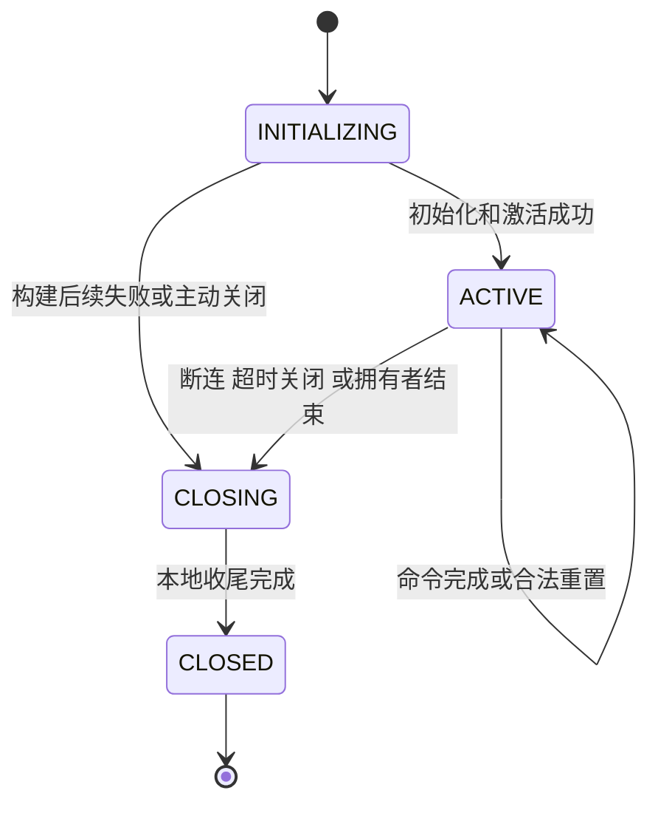

# ConnectContext 生命周期与场景问题映射

核查日期：2026-11-03。源码基线：`015dbb6b0b0d02b5352b62a72c278fde975d0613`。

`ConnectContext` 的初始化、连接池登记、线程绑定、语句资源释放和会话结束是不同操作。修复应沿用现有 `ConnectContext / ConnectScheduler / ConnectPoolMgr`，使创建方、使用方和清理责任方配对，不新增平行的会话生命周期对象，也不依赖 GC 执行业务清理。

本文覆盖客户端连接、协议请求、跨 FE 转发、内部作用域、后台任务和 HTTP 入口的代表性调用链；不是所有 `new ConnectContext()` 调用点的穷尽审计。问题分为“已确认调用链缺陷”和“待验证的生命周期契约”，后者不等同于已证明的资源泄漏。

第 1–5 节记录当前调用链与问题，第 6–8 节给出目标状态机和实现归并方案。建议把入口视角的 11 类场景归并为“客户端长会话”和“请求或任务拥有的 Context”两种模板，共用 INITIALIZING、ACTIVE、CLOSING、CLOSED 四态；借用与线程绑定是使用方式，不再建立第三类生命周期。

旧临时表的 `Env.registerSessionInfo / unregisterSessionInfo / aliveSessionSet` 登记机制及代理构造中的历史 sessionId 处理不列为问题，也不以恢复该机制为修复目标。当前 `registerSessionInfo()` 是停用的空实现。

## 1. 操作边界与持有关系

| 操作 | 当前职责 | 不应据此推断 |
| --- | --- | --- |
| 构造函数、`init()` | 创建协议适配器，初始化 QueryState、会话变量、用户变量、命令状态等 | 创建对象不等于进入客户端连接池 |
| `ConnectScheduler.submit()` | 分配 connectionId、重置登录时间 | 不执行连接池注册，也不表示异步任务已提交 |
| `ConnectPoolMgr.registerConnection()` | 检查配额、增加计数、放入 connectionMap；Flight 还建立 peer identity 索引 | 注册成功不表示后续响应和初始化一定成功 |
| `setThreadLocalInfo()` | 将 Context 绑定到当前线程 | 不是生命周期登记，也不转移资源所有权 |
| `ConnectContext.remove()` | 移除当前线程绑定 | 不关闭连接、不注销连接池、不释放全部资源 |
| `clear()` | 清空 executor、statementContext 等引用，调用协议的 afterStatement | 不是会话 cleanup；置空 StatementContext 不等于调用它的 close |
| `StatementContext.close()`、Query 注销 | 释放语句级资源或查询登记 | 不等于 ConnectContext 生命周期结束 |
| `resetConnection()` | 重置现有连接上的会话状态 | 保留连接和连接池登记，不应当做断连处理 |
| `cleanup()` | 关闭协议连接、清除调用线程绑定，并执行现有会话清理步骤 | MySQL 的连接池注销仍依赖 Channel 关闭回调 |
| `unregisterConnection()` | 释放协议会话资源、回滚会话事务、删除连接池及关联索引、扣减计数 | 各协议抵达该方法的路径不同 |

证据：[ConnectContext][ctx-init]、[submit][submit]、[连接池登记及注销][pool]、[clear][clear]、[resetConnection][reset]。

主要强引用关系：

- 客户端长会话由 `connectionMap` 持有；MySQL 还有 Channel/Listener 引用，Flight 通过 peer identity 查回同一 Context。
- 当前执行线程通过 `MoreFieldsThread` 字段或普通 ThreadLocal 持有 Context。线程池工作线程不会因为一次任务结束而自动清除该引用。[线程绑定实现][thread]
- 内部 Context 可能由局部变量、任务字段、Executor 或 Coordinator 相关对象持有，需要根据实际任务完成边界释放。
- `proxyQueryIdToConnCtx` 是转发查询取消定位索引，不是来源客户端会话的所有权登记。

对象 GC 只能回收不可达的 Java 对象，不能替代连接注销、事务处理、Query 注销或显式关闭。

## 2. 场景总览

| 场景 | 创建及持有者 | 使用边界 | 当前结束路径 | 对应问题 |
| --- | --- | --- | --- | --- |
| S01 MySQL 建连和初始化 | AcceptListener 创建；注册后连接池持有 | 接入、握手、配额登记、安装读回调 | 失败时 cleanup；注册后通常靠关闭回调注销 | P01、P02 |
| S02 MySQL 多条语句、断连、KILL、超时 | 复用连接 Context | 每次 ReadListener 工作任务绑定线程 | 正常语句 clear/remove；连接结束 cleanup 或 killConnection | R03 |
| S03 COM_RESET_CONNECTION | 原客户端连接持有 | 重置状态后继续使用 | resetConnection；不注销连接 | 保持现有重置语义 |
| S04 Flight 逻辑会话和命令 | openSession 创建；连接池和 token 索引定位 | 多个 RPC 复用同一 Context | CloseSession、KILL、空闲超时触发协议注销 | R03、R04 |
| S05 Flight 延迟取结果 | 原 Flight 会话持有 deferred executor | GetFlightInfo 返回后资源可能仍被 DoGet 使用 | 下一次查询、会话关闭或 deferred 超时回收 | 不应在单次 RPC 返回时 cleanup |
| S06 跨 FE 转发 | FrontendServiceImpl 创建代理 Context | 一次转发执行及取消定位 | StatementContext.close；finally 解绑线程并移除代理索引 | R02 |
| S07 内部同步作用域 | 统计、导出等工厂创建；包装器持有 | 一次内部 SQL 或局部操作 | AutoCloseConnectContext.clear/remove/恢复外层绑定 | R01 |
| S08 后台任务 | 任务创建或借用 Context | 作业任务、重试或加载执行 | Job 框架与 LoadTask 框架不同 | P03、R01 |
| S09 HTTP 请求及 Web SQL | 普通请求临时创建；Web SQL 另持有 JDBC 连接 | HTTP 请求或跨请求 SQL 会话 | 部分请求显式 remove；JDBC 会话由管理器关闭 | P04、R05 |
| S10 回放解析、Dummy Context、变量作用域 | helper 创建或借用已有 Context | 解析/校验/变量覆盖作用域 | 部分 finally cleanup，部分只 remove 或无收尾 | P05、R01、R05 |
| S11 FE 异常退出 | 进程内全部 Context | 进程终止 | 不能保证 Java cleanup 执行 | 集群侧资源回收边界 |

## 3. 各场景生命周期

### S01 MySQL 建连和初始化

当前调用链：

```text
AcceptListener.handleEvent
  accept → forMysql（构造及 init）→ setEnv → scheduler.submit
  → worker.execute(handleConnection)

handleConnection
  绑定线程 → 设置 scheduler → negotiate
  → registerConnection
  → 发送成功响应
  → 安装 closeListener(unregisterConnection)
  → 设置 startTime、用户超时
  → startAcceptQuery
  finally：ConnectContext.remove
```

握手或配额失败时，`handleConnection` 的 catch 会调用 cleanup。接入任务提交失败另有拒绝分支，该分支不是 `handleConnection` 的异常出口。P01、P02 分别对应这两个阶段。[AcceptListener][accept]

责任要求：接入方在连接交给正常读事件处理前，负责所有部分初始化失败的清理；注册成功之后必须存在不依赖网络回调安装结果的注销路径。

### S02 MySQL 语句、断连、KILL 和超时

`ReadListener` 暂停读事件，将命令交给工作线程，工作线程绑定已有 Context。正常语句结束后 `MysqlConnectProcessor.processOnce()` 设置 COM_SLEEP 并 clear；Listener 恢复读事件，finally 移除线程绑定。Context 继续由连接池持有。[ReadListener][read] [processOnce][mysql-process]

COM_QUIT 设置 killed 标志；网络 EOF、异常和命令处理异常也会进入连接结束路径。Listener 调用 cleanup；已安装的 Channel closeListener 负责注销连接池。已连接阶段的工作任务拒绝分支使用 try/finally 移除线程绑定，不能与 S01 的接入拒绝分支混为一谈。

KILL CONNECTION 或空闲超时可以从其他线程调用 `killConnection()`；运行中的读任务随后也可能观察到关闭并进入 cleanup。KILL QUERY 和执行超时不必结束连接。R03 对应这些并发入口，而不是普通单条 SQL 的 clear。

### S03 连接重置

`handleResetConnection()` 调用 `resetConnection()`，后者处理事务、现有会话资源、变量和 Prepared Statement 等状态，原连接继续使用。[重置入口][reset-entry]

修复 cleanup 时不能把 reset 改成注销并重建客户端连接；重置失败时也不能直接声称完整重置成功。本文不重新评审旧临时表重置实现。

### S04 Flight 逻辑会话

```text
openSession
  buildConnectContext → forFlight/init
  → 设置 env、身份、startTime、scheduler
  → scheduler.submit → registerConnection
  → 返回 token

命令
  token 查找 Context
  → callCommand 获取命令锁
  → 检查协议 closed 状态、刷新活动时间、绑定线程
  → 执行命令
  → finally 恢复原线程绑定并释放命令锁

CloseSession
  cleanup
  → FlightProtocolAdapter.closeConnection
  → unregisterConnection
  → releaseSession、closeTxn、移除池条目和 token 索引
```

Flight 的逻辑会话不能按一次传输连接或一次 RPC 的结束判断死亡。当前命令锁与 closed 状态已经处理命令串行化及关闭后的拒绝，不应重复添加另一套会话注册对象。[会话入口][flight-session] [命令作用域][flight-command]

配额拒绝分支显式调用 releaseProtocolSession，不能说完全没有清理。R04 关注的是工厂构建及注册前其他异常的资源交接，而不是否定现有配额分支。

### S05 Flight 延迟执行资源

`FlightSqlConnectProcessor.close()` 只 finalize 非 deferred executor，然后 clear/remove；它不是关闭 Flight 会话。deferred executor 被留在会话协议适配器中，供后续 DoGet 使用，并在下一次查询、会话 teardown 或空闲扫描中结束。[Processor.close][flight-close]

会话关闭与命令可能并发。现有 `tearDown` 会关闭 deferred 集合，并处理关闭后才加入的 executor。这是必须保留的异步资源约束，不能把 processor 的 close 简单替换成 Context.cleanup。[协议释放][flight-release]

### S06 跨 FE 转发

`FrontendServiceImpl.forward()` 创建代理 Context，构造 Processor，并按 queryId 登记取消定位；finally 执行线程解绑和代理索引移除。`ConnectProcessor.proxyExecute()` 的 finally 已关闭对应 StatementContext。[forward][forward] [语句释放][proxy-stmt]

来源客户端仍由接入 FE 的原 Context 持有。代理不是另一个客户端会话，不能因转发结束注销来源会话。R02 是代理本地资源退出契约的待核查项；当前没有依据仅凭“没有调用 cleanup”就判定该路径泄漏。

### S07 内部同步作用域

统计查询、导出等创建 Dummy 协议的内部 Context，并使用 `AutoCloseConnectContext` 绑定线程。该包装器退出时执行 clear、remove，并恢复 previousContext，没有执行完整 cleanup。[包装器][auto-close] [统计工厂][stats] [导出调用][export]

需要分别明确：新建 Context 的拥有者是否应在退出时完整关闭；借用已有 Context 的调用点是否只应临时绑定。R01 记录这项契约差异，不推导“每次统计查询都泄漏外部资源”。

### S08 后台任务和加载任务

两套任务框架不能统一概括为“后台任务会自动清理”：

- `InsertTask.before()` 创建并绑定 Context；任务自身的 closeOrReleaseResources 主要置空字段。外层 `TaskProcessor.closeTaskContext()` 会注销 Query、关闭 StatementContext，并在 finally remove。已覆盖线程解绑，但没有完整 cleanup。[InsertTask][insert-task] [TaskProcessor][task-processor]
- `LoadLoadingTask.executeOnce()` 在当前线程无 Context 时新建并绑定；已有 Context 时直接复用。它的 finally 注销 Query，没有解除新建 Context 的线程绑定。`LoadTask.exec()` 和 `MasterTask.run()` 也未做该解绑。P03 对应这条路径。[加载执行][load-once] [LoadTask][load-task] [MasterTask][master-task]

后台任务的 Context 必须存活到实际执行结束，而不是提交方法返回。提交失败、取消、重试、完成都应明确由谁关闭；不能关闭从调用者借来的 Context，也不能让一次任务创建的 Context 留给下一次任务。

### S09 HTTP 请求和 Web SQL

普通 HTTP 路径可能用 `new ConnectContext()` 保存当前请求身份并绑定线程，不进入客户端连接池。一个具体路径是 `ShowAction.show_meta_info()` 在启用 HTTP 认证时调用 `executeCheckPassword()`，随后可直接返回响应；该函数没有 finally 解绑。[HTTP 入口][http-show] [请求 Context 创建][rest-context]

已检查的 AuthInterceptor、ServletTraceIterceptor 和 WebConfigurer 没有统一的 Context 请求结束收尾。P04 记录这条已检查同步请求链上的绑定残留；不把所有 HTTP 路径都归为同一问题。

Web SQL 则由 `WebSqlSessionManager` 跨请求保存 JDBC Connection，并在显式关闭、过期或相关会话退出时关闭它。对应 SQL 服务端 Context 按 MySQL 生命周期管理。HTTP 请求使用的身份 Context 与 JDBC 服务端连接 Context 不能混为一体。[Web SQL 会话][websql]

### S10 解析、回放和临时变量作用域

`ConnectContextUtil.getDummyCtx()` 会新建 Context、创建 StatementContext、设置环境和身份并绑定线程；其契约要求调用者 cleanup。[Dummy helper][dummy]

不同调用点的实现不同：

- `RollupJobV2` 使用 finally cleanup，已经有明确退出路径。
- `MaterializedIndexMeta.parseStmt()` 在自行创建 Dummy Context 时通过 tmpCreate 标记决定 cleanup，不能误关借用的 Context。
- `BulkLoadJob.analyze()` 在当前线程无 Context 时调用 getDummyCtx，但没有对应 finally。P05 对应该分支。
- `AutoCloseSessionVariable` 借用已有 Context 时只恢复变量；无 Context 时可以临时创建，close 只 remove。它还包含一个静态哨兵 Context；哨兵不属于需计入客户端连接数的活跃会话。[变量作用域][vars]

嵌套作用域还应恢复外层线程绑定。仅调用当前 cleanup 的无条件 remove，并不自动满足嵌套恢复要求，见 R05。

### S11 FE 异常退出

进程崩溃、强制终止无法保证任何 Context.cleanup 被执行。进程内 Java 对象随进程消失，不等于 BE 或存储层资源已经回收。

修复本地生命周期只能保证仍在运行的 FE 正确维护注册集合。集群侧依然需要依照已登记的资源归属处理失联 FE 和旧进程实例的资源；Leader 切换也不能假定原会话执行过 cleanup。该边界不是通过新增本地会话对象解决的。

## 4. 已确认的问题及触发路径

以下结论来自当前源码调用链；“已确认”表示存在明确的退出缺口，不表示已经运行故障注入测试。

| 编号 | 场景 | 触发条件与调用链 | 可确认影响 | 修复位置与验证 |
| --- | --- | --- | --- | --- |
| P01 | S01 | registerConnection 成功后，sendResponsePacket 抛 IOException；closeListener 尚未安装；catch 调用 cleanup，而 MySQL closeConnection 只关闭 Channel | connectionMap 和连接计数未注销，Context 仍被强引用。startTime 的设置也尚未执行，不能依靠正常空闲扫描补救 | 接入/清理路径保证注册后的失败直接注销；注入响应发送失败，断言池、计数、Channel 均已清理 |
| P02 | S01 | 接入 worker.execute 抛 RejectedExecutionException；拒绝分支发送错误响应时再次抛 IOException；位于它后面的 cleanup 被跳过 | 该路径没有保证显式关闭已接收的 Channel；尚未注册连接池，不属于池条目泄漏 | 拒绝响应使用 finally 保证关闭；同时注入任务拒绝和响应发送失败 |
| P03 | S08 | LoadLoadingTask.executeOnce 在无 Context 的线程上新建并绑定，结束时仅注销 Query；LoadTask/MasterTask 未解绑 | 方法/任务退出后线程仍持有该 Context，后续工作可能复用它。此事实不意味着每个任务累计一个永久对象 | 记录是否自行创建，拥有者收尾并恢复原绑定；同一工作线程连续执行两个任务验证隔离 |
| P04 | S09 | HTTP 认证开启，show_meta_info 经 executeCheckPassword 绑定 Context 后正常返回，例如缺少 action 的早返回 | 已检查请求链没有解绑；工作线程在返回后仍可持有请求 Context。通常是每线程残留，不能直接描述为每请求无界增长 | 建立请求级 finally；验证正常、早返回、异常和线程复用；异步派发另行明确拥有者 |
| P05 | S10 | BulkLoadJob.analyze 在线程原本无 Context 时创建 Dummy Context；方法正常或异常结束都没有 finally 关闭/解绑 | 当前方法没有兑现 getDummyCtx 的清理契约，返回时线程绑定仍存在；端到端持续时间还取决于调用者边界 | 只清理自行创建的 Context；借用已有 Context 时保留它；验证两种分支及解析失败 |

证据分别见 [AcceptListener][accept]、[MySQL 关闭适配器][mysql-close]、[超时检查][timeout]、[加载执行][load-once]、[HTTP 入口][http-show]、[BulkLoadJob.analyze][bulk-analyze]。

## 5. 待验证契约及不能直接认定的问题

| 编号 | 场景 | 已知事实 | 尚需验证及修复约束 |
| --- | --- | --- | --- |
| R01 | S07/S08/S10 | 多个拥有新 Context 的路径结束时只 clear/remove，或只关闭语句资源 | 逐调用点列出持有资源和其他清理责任方，才能确认缺少 cleanup 的实际影响；不能仅凭方法名判漏 |
| R02 | S06 | 转发结束移除代理索引和线程绑定，StatementContext 已关闭 | 核实其余代理本地资源；清理不能结束来源客户端会话 |
| R03 | S02/S04 | killConnection、cleanup、协议注销入口分散；MySQL 工作线程、超时线程和关闭回调可交错 | 验证重复注销、事务关闭和注册/关闭竞争。连接计数删除已有条件保护，Flight 协议已有 closed/命令锁；不能宣称所有重复关闭都不安全 |
| R04 | S04 | 配额拒绝已释放协议资源；工厂先分配适配器，再补齐环境、身份和 scheduler | 核实构建中途抛异常的资源交接。不能在 scheduler 尚未设置时盲目套用依赖它的 Flight cleanup |
| R05 | S07/S09/S10 | cleanup 无条件 remove 调用线程绑定；部分 helper 会替换已有绑定 | 明确当前作用域是否拥有 Context，退出恢复 previousContext；没有具体跨线程调用证据时，不把 API 风险写成已发生的误解绑 |

以下不列为问题：

- 旧临时表 session 登记遗留机制。
- 正常语句结束只 clear，而保持连接存活。
- Flight 单次 RPC 结束保留逻辑会话及合法的 deferred executor。
- 代理 Context 没有进入客户端连接池。
- 仅用于内部解析的 Context 没有占用客户端连接配额。
- AutoCloseConnectContext 不调用 cleanup 这一事实本身；必须结合具体所有权与资源路径判断。

## 6. 合理的阶段划分与状态机

本节及第 7、8 节是建议的目标模型，不表示当前代码已经实现这些状态或接口。状态存放在 ConnectContext 中；不新增平行的 SessionHandle 或会话管理器。

### 6.1 阶段与主状态

建议分为四个主状态。登记与资源释放是阶段中的操作，不能把每个操作都变成一个状态。

| 主状态 | 对应阶段 | 允许的操作 | 结束条件 |
| --- | --- | --- | --- |
| INITIALIZING | 构建、补齐环境、握手或任务配置、准备登记 | 由创建者配置；必要时在初始化作用域绑定线程；不接受普通用户命令 | 初始化及激活成功进入 ACTIVE，失败或关闭进入 CLOSING |
| ACTIVE | Context 对其拥有者可用 | 执行命令、临时绑定、按现有规则重置；客户端会话接受有效请求 | 拥有者结束、连接关闭或生命周期失败进入 CLOSING |
| CLOSING | 拒绝新工作、注销、取消与资源收尾 | 已开始的执行退出；清理、完成通知及待释放资源处理 | 本地执行收尾完成，资源已释放或明确转交可靠回收责任方 |
| CLOSED | 本地生命周期结束 | 查询关闭结果、重复关闭返回已有结果 | 终态，不重新 init、注册或恢复执行 |

构造函数尚未成功返回时，可能还没有可用的 Context 对象；这部分资源由工厂自身的异常保护释放，不额外引入 NEW 或 CONSTRUCTION_FAILED 状态。



ACTIVE 表示可用，不表示正在执行 SQL；内部解析 Context 也可以是 ACTIVE，但不因此占用客户端配额。FAILED 是本次操作结果或关闭原因，不需要成为第五种生命周期状态。FE 进程崩溃不对应一次可靠执行的状态转换，仍按 S11 处理。

### 6.2 不并入主状态机的维度

| 维度 | 保留方式 | 为什么不能加入主状态 |
| --- | --- | --- |
| 是否属于客户端连接池 | 由现有连接池登记关系表达 | 内部 Context 可以可用却不登记；不存在统一的 ACTIVE 等于 REGISTERED |
| 当前线程绑定 | 词法作用域保存 previous，finally 恢复 | 一个长会话会跨线程执行多个请求，解绑不是关闭 |
| 命令执行、空闲、查询取消 | 复用命令边界、执行器和现有协议串行化机制 | 一条查询失败或被 KILL QUERY 不一定结束会话 |
| 初始化失败、断连、超时 | 关闭原因或异常结果 | 收尾步骤相同，不应复制多个关闭状态机 |
| 延迟结果和异步资源 | 由 Query/协议现有资源容器管理 | Context 可以 ACTIVE 且有未消费结果，资源寿命也可能跨 RPC |
| owned 与 borrowed | 调用作用域的所有权契约 | 同一个 Context 在拥有者处 owned，在下层函数处 borrowed，不是对象固定类型 |

COM_RESET_CONNECTION 是 ACTIVE 内的排他操作，不必增加 RESETTING 主状态。它与其他命令共用准入/串行化边界，并与关闭协调。重置失败是否保留会话由失败后的实际可用性决定，不能无条件声明重置成功或自行恢复为 ACTIVE。

### 6.3 激活与登记的顺序

客户端会话的初始化流程统一为：

```text
创建并建立失败清理责任
→ 完成身份、环境、超时等必要配置及协议握手
→ 安装关闭通知
→ 配额准入、登记并发布 ACTIVE
→ 发送成功响应或交付 token
→ 转交正常事件循环/协议会话入口
```

发送成功响应前激活是允许的，但创建方仍负责响应失败时调用 cleanup；不能认为“已经入池，所以后续失败交给 GC”。这直接覆盖 P01/P02。

必须保证：

- 关闭先发生：初始化方不能继续登记或发布 ACTIVE。
- 激活先发生：关闭方可以找到并撤销登记。
- 池查找得到的 Context 仍需在命令准入处检查可用性；查找不是一次不可撤销的执行许可。
- 计数和索引由登记机制负责，只有本次成功持有的登记能被注销；不依靠默认 connectionId 推断是否曾经注册。

实现上，激活与进入 CLOSING 必须通过同一 Context 状态协调点，单独增加一个未与登记协调的 CAS 标志不够。池配额锁与 Context 状态锁应固定顺序；一种可行顺序是激活时池锁到 Context 锁，关闭时先在 Context 锁内标记并取走登记责任、释放该锁后再注销池，禁止持有 Context 锁反向等待池锁。所有临界区只处理状态、索引和责任交接，不执行握手、响应发送、回滚或网络 IO。

### 6.4 关闭开始与关闭完成必须区分

需要 CLOSING，是因为 KILL/断连发生时，另一个工作线程可能仍在执行；把原子 closed 标记设置为 true 并不能证明清理已经完成。

建议公共关闭过程分为：

1. **停止准入。** 一次性进入 CLOSING，拒绝新命令和新的会话续租，并撤销连接池可用登记。
2. **推动退出。** 取消本 Context 拥有的执行、关闭阻塞 IO 所需的传输资源；不在 IO 回调中等待正在运行的命令持有的锁。
3. **结束资源所有权。** 工作线程从既有 finally/完成回调退出；处理本 Context 拥有的事务、语句、协议和延迟结果资源。尚被执行使用的资源不能抢先释放。
4. **完成关闭。** 本地收尾结束，才能发布 CLOSED。远端删除可以异步，但必须有明确的回收责任方和可重试记录；仅记录一条错误日志不算转交成功。

cleanup 可以发起关闭并在必要时异步完成，不必所有调用方都阻塞等待。需要等待的任务完成路径可以使用完成通知，不能占着命令锁等待自己退出。尚未实现可靠异步回收的资源，应保持可见的待清理责任，不能以“交给后台”为名直接丢弃。

从活跃连接池移除之后，尚未退出的执行或明确接管的清理任务必须继续持有 CLOSING Context，直至收尾结束；不能把“停止被续租”实现成“失去最后一个清理责任方”。关闭进度和失败原因应可观察，不能仅靠重复调用 cleanup 猜测完成情况。

关闭只能由一个责任方启动；重复调用者不重复执行回滚、扣计数等动作。现有执行 finally 仍要报告退出和释放自己拥有的资源，不能因为另一线程已设置 CLOSING 就跳过全部收尾。

不需要为了这个模型给所有内部对象引入通用引用计数：优先复用现有命令执行边界、任务完成回调和 deferred 容器。Flight 已有“关闭后新到达的 deferred executor 立即收尾”的规则必须保留；判断状态与交接资源要在共同同步边界内完成，不能变成一次无锁 isClosed 检查后再入队。

## 7. 场景归并结论

原来的 11 类是源码入口视角，混合了协议、执行阶段、资源寿命和故障事件，不宜一类对应一套生命周期实现。建议归并为两种拥有者模板，加一个通用的借用/线程绑定操作。

| 归并后模板 | 结束边界 | 原场景映射 | 保留的差异 |
| --- | --- | --- | --- |
| A 客户端长会话 | 客户端逻辑会话结束 | S01/S02/S03、S04/S05、S09 中 JDBC 对应的 SQL 服务端连接 | MySQL 握手和 Channel；Flight token 与结果容器；协议命令串行化策略 |
| B 请求或任务拥有的 Context | 一次请求、解析作用域或实际任务结束 | S06、S07、S08 中自行创建的 Context、S09 普通请求、S10 中自行创建的 Context | 业务初始化参数、实际完成回调、代理的来源会话身份 |
| 借用与绑定，不是第三类 Context | 本次使用返回 | S07/S08/S10 中借用已有 Context，以及 A 每次执行命令 | 恢复线程/变量状态，不注销、不关闭拥有者的 Context |
| 生命周期外事件 | 进程级故障 | S11 | 不能指望本地状态机或 finally 运行，交给集群恢复机制 |

具体合并判断：

- **MySQL 与 Flight 可以共用会话激活、准入、注销和关闭骨架。** 二者不同的是协议接入和资源，不是客户端 Context 的主生命周期。
- **普通语句、重置、KILL 和超时是同一会话的操作或事件。** 不各自保留一套 Context 初始化/销毁代码。
- **统计、导出、HTTP、Dummy 解析可共用 owned 作用域。** 身份、变量等业务配置保留在各自工厂，工厂失败仍须释放已经创建的资源。
- **代理与内部请求可以共用本地 Context 的关闭模板。** 代理拥有本地执行资源，仅借用来源会话的身份；“借用 sessionId”不等于“借用同一个 Context”。本地 cleanup 不能结束来源会话或回滚来源方拥有的事务。
- **异步任务可以共用关闭原语，但不能机械套用提交线程的 try-with-resources。** 作用域跟随实际任务完成；若能在 worker 内创建并执行，可直接采用模板 B 的同线程作用域。
- **Flight deferred 不单列第三种生命周期。** 它属于模板 A 的资源管理扩展；不能把单次 GetFlightInfo 返回视为 Context 结束。
- **Web SQL 持有的 JDBC Connection 与 HTTP 身份 Context 不合并成同一个对象。** 前者对应 A，后者通常属于 B；关闭 HTTP 请求不能关闭跨请求 SQL 会话。
- **FE 崩溃不纳入正常 close 实现。** 本地合并不能消除集群侧的孤儿资源回收需求。

后台任务借用 Context 时必须保证拥有者覆盖任务完整寿命，并满足同一 Context 的命令并发约束。不能只复制一个 ThreadLocal 绑定就认为可以把客户端 Context 交给后台继续使用；无法保证这些条件时，应在 worker 中创建任务自己的 Context，并显式复制需要的配置。

## 8. 实现合并与问题落点

### 8.1 合并公共职责，保留协议资源钩子

建议保留现有三个核心位置，不再让它们互相承担关闭总控：

| 位置 | 合并后的职责 | 应迁走或收敛的职责 |
| --- | --- | --- |
| ConnectContext | 状态转换、激活协调、完整 cleanup 的编排；只处理自身拥有的资源 | 不在 cleanup 中无条件移除调用线程绑定 |
| ConnectScheduler / ConnectPoolMgr | 连接 ID、配额、索引、登记及注销、超时扫描 | unregisterConnection 不再反向调用完整 cleanup；协议释放、事务处理交给公共关闭编排 |
| ProtocolAdapter 及现有协议入口 | 协议握手、关闭传输、释放协议资源、协议特有结果处理 | Flight closeConnection 不再通过池触发另一套完整关闭流程 |
| AutoCloseConnectContext 等轻量作用域 | 明确拥有新 Context 或只绑定借用 Context；恢复 previousContext | 不再用同一含混构造方式同时暗示所有权和线程绑定 |

目标调用方向：

```text
断连 / CloseSession / KILL CONNECTION / 生命周期超时 / 创建或任务失败
    → ConnectContext.cleanup
        → 状态转换与取消
        → ConnectPoolMgr 撤销登记（确实登记过才有此步骤）
        → 本地执行、事务和资源收尾
        → ProtocolAdapter 关闭传输、释放协议资源
        → 完成通知

Channel 关闭回调
    → 再次请求同一 cleanup
    → 已关闭中则不重复启动；不能递归执行整套释放
```

上图表示单向职责关系，不规定所有资源的物理释放顺序；阻塞 IO 的关闭可能必须早于执行退出，而被执行线程使用的缓冲区必须等安全释放点。应保持第 6.4 节的依赖关系。

公共 Context 生命周期作为会话可用性的唯一依据。Flight 资源容器的封口、命令锁等局部同步仍可保留，它们用于容器竞态和串行化，不再独立定义另一种会话存活状态。迁移时不能直接删除现有 closed 检查而丢失 deferred 交接保护。

### 8.2 两个明确的作用域入口

可以演进现有 AutoCloseConnectContext，提供明确的 owned 和 bind 入口，而不是新增会话对象。以下名字仅用于表达契约：

```java
try (var owned = AutoCloseConnectContext.owned(() -> createInternalContext())) {
    execute(owned.connectContext);
} // 完整关闭自己创建的 Context，finally 恢复 previousContext

try (var binding = AutoCloseConnectContext.bind(existingContext)) {
    use(existingContext);
} // 只恢复 previousContext，不 clear 或 cleanup 借用对象
```

owned 入口不能靠包装器接管前已经成功返回的对象来掩盖工厂中途失败；工厂负责构造未完成阶段，包装器负责接管后的阶段。初始化需要线程绑定时，由初始化作用域同样保证恢复。

单条命令的语句资源释放继续由命令/StatementContext 边界处理。不能把 bind.close 变成 clear：嵌套借用外层 Context 时，clear 可能破坏外层正在使用的 executor。Prepared Statement 和 deferred executor 的所有权也不能被普通一次性语句清理误吞。

对于异步任务，优先在实际执行的 worker 中创建 owned 作用域；确需提前创建时，提交成功后明确交接到任务完成路径，提交失败仍由提交者清理。任务取消与完成的交错复用同一 cleanup，不另外建一套 Job 关闭状态机。

### 8.3 缺陷按公共修复点归并

| 公共修复点 | 覆盖问题或待核查项 | 避免的重复实现 |
| --- | --- | --- |
| 客户端初始化失败保护及激活/关闭协调 | P01、P02、R04、R03 的注册竞争 | MySQL 接入错误、Flight 打开失败分别补零散 cleanup |
| owned 与 bind 两种明确作用域 | P03、P04、P05、R01、R05 | 统计、Load、HTTP、解析各自维护 remove/cleanup 条件 |
| ConnectContext 公共关闭骨架与单向协议钩子 | R03、R04 的关闭收尾 | killConnection、cleanup、Channel 回调、Flight 注销重复处理资源 |
| 代理采用内部 owned 模板并限定本地资源归属 | R02 | 为代理新增另一套会话注册与生命周期管理 |
| 保留现有命令及 deferred 资源同步 | S05、R03 | 把延迟结果再做成一类独立 Context 生命周期 |

可以共享作用域原语，不代表所有框架入口能合成一个函数：HTTP 请求 finally、Load worker finally、Job 完成回调仍分别位于它们真实的执行边界。合并的是状态规则和资源责任，不是用一个大型 execute(mode, flags...) 分支覆盖所有业务。

## 9. 验证矩阵与推进顺序

| 验证场景 | 核心断言 |
| --- | --- |
| MySQL 握手失败、配额拒绝 | Channel 关闭；连接计数与注册前一致 |
| 注册成功后发送响应失败 | P01 的池条目和用户计数恢复，不能依赖超时或 GC |
| INITIALIZING 与关闭并发 | 关闭先发生则不能登记；激活先发生则最终准确注销；没有 CLOSING 回到 ACTIVE |
| 运行中请求遇到关闭 | 新请求被拒绝，旧请求可进入 finally；本地资源尚未收尾时不报告 CLOSED |
| 初始化中途失败 | 已分配资源由创建方释放；没有 Context 对象时也能关闭先取得的协议资源 |
| 重复关闭及关闭回调重入 | 仅一个关闭发起者；重复调用不递归释放、不重复扣减，完成状态可查询 |
| 接入任务拒绝且错误响应失败 | P02 仍显式关闭 Channel |
| 正常多条 SQL | 每条语句结束解绑线程，Context 继续注册可用 |
| COM_RESET_CONNECTION | 状态重置，连接及计数保留；失败不能报告完整成功 |
| KILL、超时、读线程退出交错 | 状态终止一次，索引和计数正确，事务处理不重复产生错误 |
| Flight 命令结束与会话结束 | RPC 结束不注销 token；CloseSession 后 token 不再可用 |
| Flight deferred 与关闭竞争 | 已登记及关闭后到达的 deferred executor 都有正确收尾 |
| 内部 owned/borrowed/nested 作用域 | 新建对象按责任关闭；借用对象不关闭；外层线程绑定恢复 |
| 同工作线程连续加载任务 | 前一个新建 Context 不残留给下一个任务 |
| HTTP 正常、早返回、异常 | 请求结束后原线程状态恢复，跨请求不复用残留 Context |
| 代理转发成功和失败 | 本地 Query/语句资源结束，来源会话保留 |
| FE 进程异常退出 | 不以 cleanup 回调发生作为集群资源回收的前提 |

实现前先固定第 6–8 节的状态及所有权契约。随后建立最小公共关闭/登记协调与 owned/bind 原语，先迁移 MySQL 接入和一个内部拥有者路径；验证 P01/P02 后，再用同一原语迁移 P03/P04/P05。Flight、代理和异步任务按各自资源边界迁移，保留已有 deferred 保护，不做全仓 cleanup 机械替换。并发测试使用 latch/barrier 控制交错，不依靠 sleep 猜测，不通过 System.gc 验证正确性。

现有 [ConnectPoolMgrTest][pool-test] 覆盖部分注销与计数行为，[FlightSessionsInConnectPoolTest][flight-test] 覆盖 CloseSession、KILL、空闲超时，[ConnectContextTest][ctx-test] 覆盖 reset、线程绑定和 deferred executor 部分清理。它们不是 P01–P05 已通过验证的证明；本次文档整理未运行这些测试。

## 10. 核查结论与边界

| 检查项 | 结论 |
| --- | --- |
| 目标与正确性 | 形成场景—调用链—问题—验证映射，并给出四态与两种拥有者模板；P01–P05 有具体触发路径，R01–R05 保留验证边界 |
| 最小范围与复用 | 仅文档变更；建议复用现有 Context/连接池、协议适配器和轻量作用域，未引入实现或新会话管理对象 |
| 并发及锁 | 明确 MySQL 读任务、超时线程、关闭回调及 Flight 命令/关闭并发；尚未进行竞态故障注入 |
| 生命周期 | 区分创建、登记、绑定、语句释放、任务完成、会话结束，覆盖 owned/borrowed 与部分构建失败 |
| 平行路径 | 对比 MySQL、Flight、代理、内部任务、HTTP；代表性路径之外的构造点仍需逐一核查 |
| 异常与条件 | P01/P02 为明确 IO 异常路径；内部任务按是否自行创建决定收尾，避免误关借用对象 |
| 性能 | 修复不依赖每次续租写 Journal 或 GC 扫描；避免在登记锁内做 RPC/资源回收 |
| 配置与兼容性 | 本次无新增配置、协议字段、存储格式或行为修改 |
| 事务及持久化 | 记录现有 closeTxn 归属与异常退出边界；未修改事务、Journal 或版本发布逻辑 |
| 数据不变量 | 本文不改变已提交/未提交数据可见性、Partition visible version、MoW delete bitmap；相关实现不在此次评审范围 |
| 资源与失败处理 | 核实强引用保留和显式收尾缺口；没有将所有未调用 cleanup 的上下文断定为泄漏 |
| 测试与结果 | 给出验证矩阵和已有测试位置；无新增或改写测试结果，无运行时复现结论 |
| 可观测性 | 后续修复应可关联 connectionId、生命周期阶段及失败原因；Flight 原始 token 不应出现在日志中 |

## 源码索引

以下链接指向本地核查工作区；行号对应文首源码基线。

- 基础机制：[初始化][ctx-init]、[连接登记][pool]、[线程绑定][thread]、[作用域包装器][auto-close]。
- 客户端与转发：[MySQL 接入][accept]、[读事件][read]、[Flight 会话][flight-session]、[跨 FE 转发][forward]。
- 内部执行：[统计查询][stats]、[导出][export]、[Job 任务框架][task-processor]、[Load 执行][load-once]、[回放解析][bulk-analyze]。
- HTTP：[请求 Context][rest-context]、[Show 接口][http-show]、[Web SQL 会话][websql]。

[ctx-init]: /Users/zhangwenxin/workplace/code/doris/incubator-doris/fe/fe-core/src/main/java/org/apache/doris/qe/ConnectContext.java:417
[submit]: /Users/zhangwenxin/workplace/code/doris/incubator-doris/fe/fe-core/src/main/java/org/apache/doris/qe/ConnectScheduler.java:75
[pool]: /Users/zhangwenxin/workplace/code/doris/incubator-doris/fe/fe-core/src/main/java/org/apache/doris/qe/ConnectPoolMgr.java:116
[clear]: /Users/zhangwenxin/workplace/code/doris/incubator-doris/fe/fe-core/src/main/java/org/apache/doris/qe/ConnectContext.java:1034
[reset]: /Users/zhangwenxin/workplace/code/doris/incubator-doris/fe/fe-core/src/main/java/org/apache/doris/qe/ConnectContext.java:366
[thread]: /Users/zhangwenxin/workplace/code/doris/incubator-doris/fe/fe-core/src/main/java/org/apache/doris/nereids/util/MoreFieldsThread.java:80
[accept]: /Users/zhangwenxin/workplace/code/doris/incubator-doris/fe/fe-core/src/main/java/org/apache/doris/mysql/AcceptListener.java:56
[read]: /Users/zhangwenxin/workplace/code/doris/incubator-doris/fe/fe-core/src/main/java/org/apache/doris/mysql/ReadListener.java:48
[mysql-process]: /Users/zhangwenxin/workplace/code/doris/incubator-doris/fe/fe-core/src/main/java/org/apache/doris/qe/MysqlConnectProcessor.java:567
[reset-entry]: /Users/zhangwenxin/workplace/code/doris/incubator-doris/fe/fe-core/src/main/java/org/apache/doris/qe/ConnectProcessor.java:152
[flight-session]: /Users/zhangwenxin/workplace/code/doris/incubator-doris/fe/fe-core/src/main/java/org/apache/doris/arrowflight/sessions/FlightSessionsInConnectPool.java:67
[flight-command]: /Users/zhangwenxin/workplace/code/doris/incubator-doris/fe/fe-core/src/main/java/org/apache/doris/arrowflight/protocol/FlightProtocolAdapter.java:592
[flight-close]: /Users/zhangwenxin/workplace/code/doris/incubator-doris/fe/fe-core/src/main/java/org/apache/doris/arrowflight/FlightSqlConnectProcessor.java:202
[flight-release]: /Users/zhangwenxin/workplace/code/doris/incubator-doris/fe/fe-core/src/main/java/org/apache/doris/arrowflight/protocol/FlightProtocolAdapter.java:276
[forward]: /Users/zhangwenxin/workplace/code/doris/incubator-doris/fe/fe-core/src/main/java/org/apache/doris/service/FrontendServiceImpl.java:1168
[proxy-stmt]: /Users/zhangwenxin/workplace/code/doris/incubator-doris/fe/fe-core/src/main/java/org/apache/doris/qe/ConnectProcessor.java:665
[auto-close]: /Users/zhangwenxin/workplace/code/doris/incubator-doris/fe/fe-core/src/main/java/org/apache/doris/qe/AutoCloseConnectContext.java:38
[stats]: /Users/zhangwenxin/workplace/code/doris/incubator-doris/fe/fe-core/src/main/java/org/apache/doris/statistics/util/StatisticsUtil.java:189
[export]: /Users/zhangwenxin/workplace/code/doris/incubator-doris/fe/fe-core/src/main/java/org/apache/doris/load/ExportTaskExecutor.java:151
[insert-task]: /Users/zhangwenxin/workplace/code/doris/incubator-doris/fe/fe-core/src/main/java/org/apache/doris/job/extensions/insert/InsertTask.java:153
[task-processor]: /Users/zhangwenxin/workplace/code/doris/incubator-doris/fe/fe-core/src/main/java/org/apache/doris/job/executor/TaskProcessor.java:93
[load-once]: /Users/zhangwenxin/workplace/code/doris/incubator-doris/fe/fe-core/src/main/java/org/apache/doris/load/loadv2/LoadLoadingTask.java:168
[load-task]: /Users/zhangwenxin/workplace/code/doris/incubator-doris/fe/fe-core/src/main/java/org/apache/doris/load/loadv2/LoadTask.java:85
[master-task]: /Users/zhangwenxin/workplace/code/doris/incubator-doris/fe/fe-core/src/main/java/org/apache/doris/task/MasterTask.java:31
[http-show]: /Users/zhangwenxin/workplace/code/doris/incubator-doris/fe/fe-core/src/main/java/org/apache/doris/httpv2/rest/ShowAction.java:76
[rest-context]: /Users/zhangwenxin/workplace/code/doris/incubator-doris/fe/fe-core/src/main/java/org/apache/doris/httpv2/rest/RestBaseController.java:116
[websql]: /Users/zhangwenxin/workplace/code/doris/incubator-doris/fe/fe-core/src/main/java/org/apache/doris/httpv2/websql/WebSqlSessionManager.java:220
[dummy]: /Users/zhangwenxin/workplace/code/doris/incubator-doris/fe/fe-core/src/main/java/org/apache/doris/qe/ConnectContextUtil.java:40
[vars]: /Users/zhangwenxin/workplace/code/doris/incubator-doris/fe/fe-core/src/main/java/org/apache/doris/qe/AutoCloseSessionVariable.java:26
[mysql-close]: /Users/zhangwenxin/workplace/code/doris/incubator-doris/fe/fe-core/src/main/java/org/apache/doris/mysql/protocol/MysqlProtocolAdapter.java:350
[timeout]: /Users/zhangwenxin/workplace/code/doris/incubator-doris/fe/fe-core/src/main/java/org/apache/doris/qe/ConnectContext.java:1344
[bulk-analyze]: /Users/zhangwenxin/workplace/code/doris/incubator-doris/fe/fe-core/src/main/java/org/apache/doris/load/loadv2/BulkLoadJob.java:309
[pool-test]: /Users/zhangwenxin/workplace/code/doris/incubator-doris/fe/fe-core/src/test/java/org/apache/doris/qe/ConnectPoolMgrTest.java:190
[flight-test]: /Users/zhangwenxin/workplace/code/doris/incubator-doris/fe/fe-core/src/test/java/org/apache/doris/arrowflight/sessions/FlightSessionsInConnectPoolTest.java:119
[ctx-test]: /Users/zhangwenxin/workplace/code/doris/incubator-doris/fe/fe-core/src/test/java/org/apache/doris/qe/ConnectContextTest.java:86
