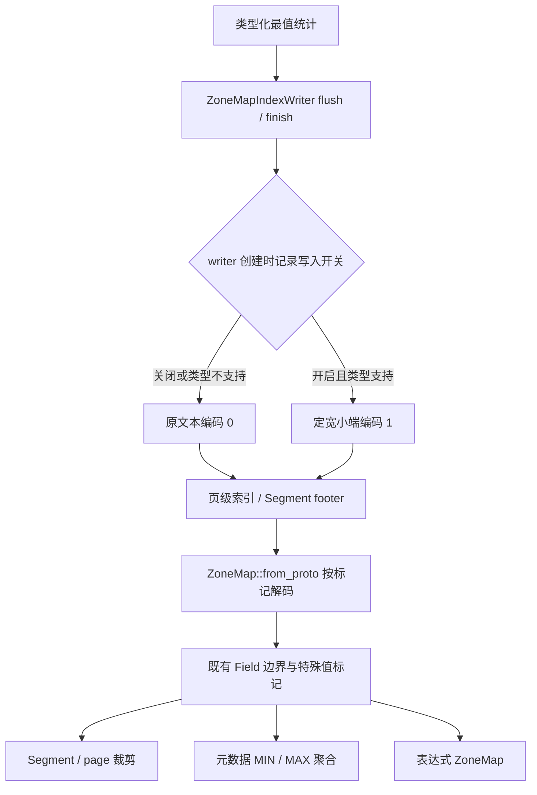

# ZoneMap 二进制边界编码

## 范围与调用链

基于 Apache Doris master `f937d950d45313f20864d287df453e1b90f5c615`。
现有最值统计已经使用类型化值；本次改变页级与 Segment 级 ZoneMap 边界的持久化编码，
消除支持类型的文本格式化与解析。字符串截断、比较器、事务与 rowset 生命周期不变。

## 支持的 19 种类型

宽度为单个 min 或 max；一对边界需要两倍，另有 protobuf 字段开销。

| 类型 | 字节 | 持久化内容 |
|---|---:|---|
| BOOLEAN | 1 | UInt8 布尔值 |
| TINYINT | 1 | Int8 二补码 |
| SMALLINT | 2 | Int16 二补码，小端 |
| INT | 4 | Int32 二补码，小端 |
| BIGINT | 8 | Int64 二补码，小端 |
| LARGEINT | 16 | Int128 二补码，小端 |
| FLOAT | 4 | IEEE 位模式，小端，保留负零 |
| DOUBLE | 8 | IEEE 位模式，小端，保留负零 |
| DECIMAL32 | 4 | 未缩放 Int32 |
| DECIMAL64 | 8 | 未缩放 Int64 |
| DECIMAL128I | 16 | 未缩放 Int128 |
| DECIMAL256 | 32 | 未缩放 Int256，四个 64 位 limb 从低到高分别小端编码 |
| DATEV2 | 4 | 现有打包日期 UInt32 |
| DATETIMEV2 | 8 | 现有年月日时分秒微秒打包值 UInt64，不是 epoch 微秒 |
| TIMESTAMPTZ | 8 | 现有 UTC DATETIMEV2 打包值，不另存时区，不做会话时区转换 |
| TIMESTAMP_NS | 8 | 有符号 epoch 纳秒 Int64，包括负数 |
| IPv4 | 4 | 现有 UInt32 地址值，小端，不是网络字节序 |
| IPv6 | 16 | 现有 UInt128 地址值，小端，不是网络字节序 |
| UUID | 16 | UUID 对应 UInt128 数值，小端，不使用外部 big-endian 字节接口 |

Decimal 的 precision/scale 继续来自列 schema，不在每个边界里重复存储。
旧 DATE(V1)、DATETIME(V1)、DECIMALV2 不加入二进制编码；它们现有的文本读写路径保留，
避免破坏存量文件。SQL 类型名称可能映射到现代内部类型，范围按上表的 PrimitiveType 区分。

CHAR/VARCHAR/STRING 保留原字符串编码与截断规则。TIMEV2、内部无符号 offset、
DISCRETE_DOUBLE、FIXED_LENGTH_OBJECT 等没有对应的可用持久化 ZoneMap writer，
不在本次扩展。复杂类型的句柄不等于定宽标量，不复制其对象内存。

## 磁盘格式与读取

保留 ZoneMapPB 字段 1—8，新增 optional uint32 `value_encoding = 9 [default = 0]`。
已核对 branch-3.1/4.0/4.1/4.2/master：9 未被占用，旧字段的含义不变。

- 0 或字段缺省：原文本/字符串编码。
- 1：上表的固定宽度小端编码。

每个 ZoneMap 自描述，读取不依赖当前写入开关。不同编码的 Segment 可同时存在；
页级索引中的每个 ZoneMapPB 也独立携带标记。未知编码返回 NotSupported，
支持类型的二进制长度错误返回 Corruption，不尝试文本解析或猜测恢复。
不支持的类型若被标为二进制，返回 NotSupported。

编码不是排序键：必须恢复 Field 后使用既有比较语义，不能用 memcmp 判大小。
使用 util/coding.h 的定宽编码工具及 std::bit_cast，不持久化宿主端序、对象 padding 或指针。
空页、全 NULL 和 pass_all 没有有效边界，仍写空边界、不设置二进制标记。
NaN/正负无穷保持既有标记与恢复语义；历史浮点文件缺失 has_nan 时仍走原保守读取逻辑。

## 升级、混部与回退

BE 动态配置 `enable_binary_zone_map` 默认 false，只影响之后创建的 writer。
每个 writer 构造时记录开关，页级 flush 和 Segment finish 使用同一策略。
改变开关不会影响已创建的 writer；读取始终识别两种格式。

1. 升级所有可能读这些文件的 BE/读端，包括备份恢复、克隆和共享存储的消费者。
   混部期间必须保持写入开关关闭。
2. 所有读端具备新格式读取能力后，再统一打开二进制写入。
3. 关闭开关只影响后续创建的 writer，已有 writer 仍按原策略完成写入；不会转换历史文件。

旧 BE 不认识编码 1，不能直接读取新格式；protobuf 可跳过未知字段不代表能正确解释 min/max。
不使用假文本边界或 pass_all 伪装兼容，因为旧版的裁剪和元数据 MIN/MAX 都可能消费边界。

回退旧 BE 前：关闭开关，等待已有二进制 writer 完成，使用支持新格式的版本重写全部相关
文件（不能只依赖普通 compaction 覆盖的子集），处理克隆、备份、旧版本等依赖，确认所有
可能被回退后读端访问的文件都不再使用编码 1，再执行降级。

## 验证

- 19 种类型分别验证 nullable/non-nullable、文本与二进制往返、页级和 Segment 级索引
  写文件并重载、Field 最值以及 EQ 裁剪；覆盖整数极值、Decimal 非零 scale 与 Int256 limb。
- 日期时间边界、0/3/6 微秒 scale、负 epoch 纳秒；IP/UUID 全零、全一与固定字节样例。
- 独立 golden bytes 验证小端规则，防止 encoder/decoder 对称错误；FLOAT/DOUBLE 验证负零，
  并各覆盖 127 种非空特殊值组合，保留 NaN/Inf 行为。
- 历史字段 1—4 的固定 protobuf 字节，验证缺省编码读取；显式 0、编码 1 与写入开关无关，
  混合读取时复用目标对象；重复使用 PB 写文本时清除之前的二进制标记。
- 旧 DATE/DATETIME/DECIMALV2 即使请求新编码也保持完全相同的文本 PB，且拒绝其编码 1。
- 损坏长度、未知编码、不支持类型、空/全 NULL/pass_all、writer 开关快照。

本轮运行 `run-be-ut.sh -j48 --run --filter=ColumnZoneMapTest.*`，ASAN_UT 39/39 PASS。
clang-format 16.0.6、build hygiene、跨分支字段编号核对和 diff 检查通过；新增 benchmark
使用实际 UT 编译参数做 C++ 语法检查通过。头文件通过实际包含它们的翻译单元做静态检查，
避免单独分析头文件时与 PCH 重复定义；改动行 clang-tidy 检查全部通过，完整日志保存在本地 validation/。
完整 SQL 集群回归、真实混部升级/降级、RELEASE 性能测试、ARM 与大端运行未执行。

## 性能边界

收益集中在每页/每个 Segment 边界的格式化和解析，不改变逐行最值统计成本。
定宽编码不保证所有值都更小：INT 的文本 0/1 比两个 4 字节整数更短。
保留 encode/decode 对照 benchmark（BIGINT/Decimal256，文本/二进制），不把 add_values
benchmark 当作编码优化证据，也不在未运行正式性能测试时声称具体 CPU 提速。

此前通过生成的 protobuf 实测的完整 ZoneMapPB ByteSize：

| 边界 | 文本 | 二进制 |
|---|---:|---:|
| BIGINT 极小/极大 | 55 B | 34 B |
| INT 0/1 | 18 B | 26 B |
| Decimal256 -10^75 / 10^75 | 169 B | 82 B |

这只是消息体大小，不代表压缩后的全表大小。正式性能测试应分别衡量编码/解码、导入和
冷/热查询的 CPU 与实际索引大小，并覆盖小整数、大整数、Decimal、常量及随机分布。

## 自审检查点

| 检查点 | 结论 |
|---|---|
| 目标与证据 | 去掉 19 种类型边界的文本转换；测试覆盖实际文件与既有裁剪比较器 |
| 最小性与复用 | 一处类型分派供读写使用；复用定宽编码和 Field 构造，不改变比较器或数据页 |
| 并发与锁 | 不新增线程、锁或共享可变状态；沿用现有动态配置读取模式，writer 保存快照 |
| 生命周期与静态初始化 | 字节由原 PB/索引对象持有；编码 id 为 constexpr，无跨 TU 动态初始化依赖 |
| 配置 | 动态写入开关默认 false；已创建的 writer 策略稳定，读路径与开关无关 |
| 磁盘兼容 | 新读旧与新读新；混部先关闭开关；旧读新不支持，回退要求重写 |
| 协议 id | 已核对所有维护分支，新增字段 9 为 optional，原有含义不变 |
| 平行路径 | 页级和 Segment 级共同序列化；既有裁剪、表达式和元数据聚合统一解码 |
| 条件与错误 | 长度损坏、未知编码等有具体负例，返回非 OK；文本容错行为不扩展 |
| 覆盖与测试结果 | 见验证节；不手写回归 .out，单元测试固定字节属于协议测试输入 |
| 可观测性 | 编码与长度错误包含上下文，标记随 PB 持久化；不增加逐页 INFO 日志 |
| 事务与持久化 | 沿用原 Segment/index/rowset 提交，不涉及 EditLog 或版本可见性变更 |
| 写入原子性与崩溃 | 无旁路文件或发布步骤，沿用已有 Segment 发布原子性 |
| FE/BE 变量 | 无新增 FE 到 BE 传递变量；只有 BE 本地写入配置 |
| 性能与内存 | 不新增缓存或常驻分配；边界字符串归现有 PB 所有；小整数可能增大 |
| 其他限制 | 不扩展旧类型；ARM、大端、完整 SQL 集群与实际滚动升级需要相应环境验证 |
