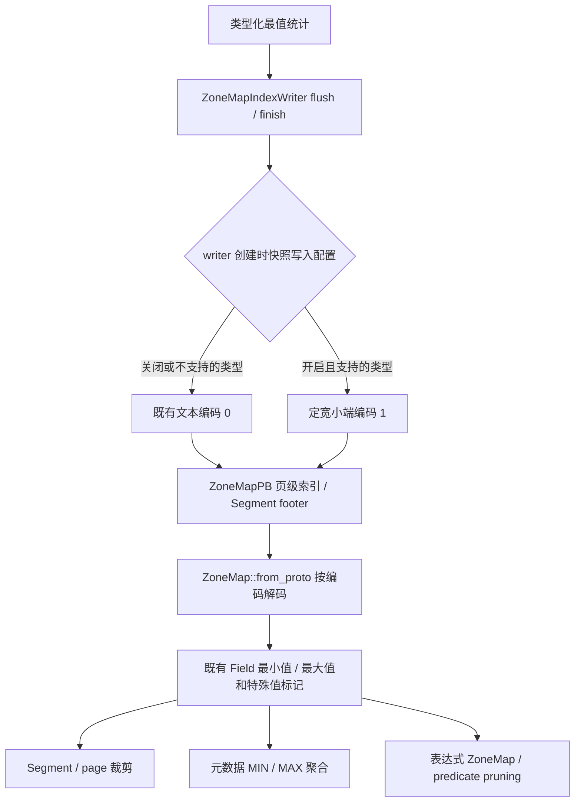

# ZoneMap 二进制边界编码重构方案

## 目标与现状

基线为 Apache Doris master 091925a5629d74e6e35bb3b250b3f44114d79f0e（2026-10-15）。
`ZoneMap::to_proto` 把 Field 经 `to_olap_string` 写入 ZoneMapPB.min/max；
`from_proto` 经 `from_zonemap_string` 恢复 Field。页级和 Segment 级均走这条链路。
页级索引保存在不压缩、PLAIN_ENCODING 的 IndexedColumn 中。运行时统计最值已经使用
类型化原生值，本次聚焦 flush/finish 和读取索引的格式转换，不重写最值统计算法。

目标：消除支持类型边界的十进制格式化/解析，保留精确浮点位模式，减少大整数和
高精度 Decimal 的边界字节数。二进制定长不保证所有值都更小：例如 INT 的字符 `1`
只有一字节，定长需要四字节。必须同时报告 CPU 和实际索引大小，不能泛化为空间必然下降。

## 调用链与改动边界



`ColumnReader` 和 `SegmentIterator` 的现有消费者均继续使用 `ZoneMap::from_proto`，
本次不改变比较器、事务可见性、delete bitmap 或 rowset 生命周期。

## 磁盘格式

保留 ZoneMapPB 原字段 1—8，追加 optional uint32 value_encoding = 9 [default = 0]。
已核对 branch-3.1/4.0/4.1/4.2 的相同消息，9 尚未使用，既有字段含义不改变。
0（或缺省）：现有文本/字符串边界；1：V1 定长小端二进制边界。
min/max 的解释由该字段决定，每个 ZoneMap 自描述，允许同一索引中混合旧/新编码。
schema 中的逻辑类型决定宽度与解释，Decimal 的 precision/scale 仍由列 schema 提供，
不在每个 min/max 内重复。编码不是排序键，必须解码后按现有类型比较，禁止 memcmp 判大小。

首批编码：BOOL/TINYINT 1B、SMALLINT 2B、INT/FLOAT/DECIMAL32 4B、
BIGINT/DOUBLE/DECIMAL64 8B、LARGEINT/DECIMAL128 16B、DECIMAL256 32B。
整数保存二补码位模式，浮点保存 IEEE 位模式，Decimal 保存未缩放整数；
256 位整数按低位到高位的四个 64 位 limb 分别小端编码，不依赖结构体布局。
字符串/CHAR/VARCHAR、旧 DECIMALV2、日期时间/IP/UUID 等其他类型本阶段继续使用 0。
后续扩展必须逐类审计执行类型与 StorageFieldType 的差异，尤其 DATE V1/DECIMALV2。

不持久化 C++ 对象、Field tag、指针、padding 或宿主端序。优先复用 util/coding.h 的
定宽小端编码和 unaligned 工具。空页、全 NULL、pass_all 的 min/max 无效，仍写旧编码空边界。
has_null/has_not_null、NaN/正负无穷标记、字符串截断及最大值进位语义不变。

## 接口与错误处理

把 ZoneMap::to_proto 的实现移出头文件，共用一处类型到二进制 codec 的映射。
新增 use_binary_encoding 参数（默认 false），页级和 Segment 级 writer 传入相同策略。
每个 writer 构造时快照 BE 配置，避免配置变化使其行为不可预测。
from_proto 自动区分两种编码，支持新读旧；未知版本或支持类型不匹配返回 NotSupported，
二进制边界长度不正确返回 Corruption，不能退回文本解析，也不能把损坏的边界交给 MIN/MAX 聚合。
旧文本数据原有容错行为保持，不扩大本次改动范围。

## 升级、降级和开关

新增 BE 动态配置 enable_binary_zone_map，默认 false，只影响之后创建的 writer，
不影响读取。先部署具备双格式读取能力的全部 BE，再统一打开新写入。
旧版 BE 不认识编码 1，不能读取新格式；不能假定 protobuf unknown-field 或 pass_all
即可安全兼容。已确认 branch-3.1 的 predicate pruning、MIN/MAX 元数据聚合等路径
会直接解析/消费 min/max，不能用假边界加 pass_all 掩盖格式变化。

关闭开关只让后续创建的 writer 写旧格式，已存在的 binary writer 仍会完成新格式写入；
必须等待这些 writer 完成，且不会自动转换既有文件。需要降级时，先关闭开关，用具备双格式
读取能力的版本完整重写/compaction 所有二进制数据，并清理不再需要的旧版本、克隆及备份依赖，
核实无编码 1 的存量文件后才可降级。重写必须包括未被普通 compaction 覆盖的文件。
默认关闭是发布兼容门禁，不声称旧 BE 能读取新编码。

不双写字符串和二进制，因为那会保留转换开销且增加存储。不上来引入新的 Segment
容器、varint、自适应压缩或全量元数据缓存，先隔离单一编码优化的收益。

## 验证与衡量

1. codec：所有首批类型、最小/最大值、负数、零、Decimal256 四个 limb、非零 scale，
   精确小端 golden bytes、浮点负零、反向读取、长度损坏与未知版本。
2. 兼容：历史文本/缺省字段、显式 0、二进制/文本混合；开关关闭时写入字节保持旧行为；
   Unsupported 类型不改变；全 NULL/空/pass_all、NaN/Inf 标记不变；同一个 PB 重用不残留编码。
3. 索引：写文件、加载页级与 Segment 级、比较实际 Field，验证 predicate pruning；
   复用现有浮点组合语料，在开启二进制写入时验证 FLOAT/DOUBLE 各 127 种非空特殊值组合；
   开启新写入后运行原有 ZoneMap UT 覆盖字符串、浮点及特殊状态。
4. 性能：在相同 ASAN 构建中做有界的转换对比，仅作诊断；正式吞吐结论需另用用户授权的
   RELEASE 构建，分别测 encode/decode、完整导入、冷/热索引查询及 MIN/MAX 聚合。
   对大整数/Decimal、近零小整数、常量、随机值分别记录 protobuf/index 字节和 CPU。
   不把每行最值统计 benchmark 当成格式转换性能证据。

## 实际 protobuf 字节数样例

使用修改后的 segment_v2.proto 生成 Python protobuf 消息，保持全部现有布尔标记相同，
只改变 min/max 与编码标记。以下是完整 ZoneMapPB 的 ByteSize，而非压缩后的 Segment 大小：

| 输入边界 | 文本 PB | 二进制 PB | 解释 |
|---|---:|---:|---|
| BIGINT 最小值与最大值 | 55 B | 34 B | 减少 21 B |
| INT 的 0、1 | 18 B | 26 B | 增加 8 B，定长编码不保证小值更省 |
| Decimal256 的 -10^75、10^75 | 169 B | 82 B | 减少 87 B |

该结果验证编码结构的空间差异，不代表实际全表空间或 CPU 吞吐测试。
证据：validation/check_proto_size.py、validation/protobuf-size.json。

## 后续阶段

首阶段完成双格式读写、灰度开关和正确性验证后，再分别评估：
- 对小整数采用 ZigZag/varint 的新编码（必须分配新的编码版本，不能改变编码 1）。
- 合并页级标记或列式存储边界，减少每页 protobuf 固定开销。
- 索引加载后缓存类型化边界，减少重复解码；明确额外内存、生命周期及 MemTracker 归属。
- 压缩索引页；单独衡量随机读取、解压 CPU 与空间，不与编码改动混合归因。
- 日期/IP/UUID 等类型编码扩展；不能未经审计直接序列化 C++ struct。
这些均不混入本次实现，以便测出独立收益、缩小兼容面。

## 自审关键检查点

| 检查点 | 结论 |
|---|---|
| 目标与证据 | 已移除支持类型的边界格式化/解析；UT 和空间样例覆盖，完整运行状态见下节 |
| 最小性与复用 | 复用小端/unaligned 工具，一处类型映射供读写使用；不改数据页/比较器 |
| 并发与锁 | 不新增线程/锁；遵循既有动态配置读取模式，writer 构造时快照策略 |
| 生命周期与静态初始化 | 编码临时字符串归 PB/IndexedColumn 所有，只有 constexpr 编码 id，无跨 TU 动态初始化 |
| 配置 | 动态 enable_binary_zone_map=false；新 writer 可见，既有 writer 策略不变 |
| 磁盘兼容 | 新读旧；旧读新不支持，滚动升级期间必须保持关闭，不伪装 pass_all |
| Proto id | 已逐一核对 3.1/4.0/4.1/4.2，optional field 9 未冲突 |
| 平行路径 | page flush 和 Segment finish 均接入同一 to_proto；读路径统一 from_proto |
| 条件分支 | 损坏长度和未知编码有可复现负例并返回错误，不猜测恢复格式 |
| 覆盖范围 | 数值/Decimal256、NULL/pass_all、浮点特殊值、PB 重用、文件索引及配置快照 |
| 结果文件 | 未手写回归 .out；新增的是 BE UT，protobuf 空间证据由生成消息计算 |
| 可观测性 | 既有 Status 含编码/长度/类型错误，编码保存在 PB 中；无逐页 INFO 日志 |
| 事务与持久化 | 仍随既有 Segment/index 写入及 rowset 提交，不修改 EditLog/事务协议 |
| 写入原子性与崩溃 | 不增加旁路文件或新发布步骤，沿用既有 Segment 写入原子性 |
| FE/BE 变量 | 无新增 FE 到 BE 变量，仅 BE 本地写入策略 |
| 性能和内存 | 去掉数字文本转换；沿用 Field/PB 内存模型；小整数可能膨胀，需按分布测量 |
| 其他风险 | 大端机器未实测，固定 golden bytes/limb 布局可静态验证；新格式启用后降级需要重写 |

## 本次落地与结果

实现文件：
- gensrc/proto/segment_v2.proto：optional value_encoding=9。
- be/src/storage/index/zone_map/zone_map_index.{h,cpp}：共享 codec、双格式读取、writer 策略快照。
- be/src/common/config.{h,cpp}：默认关闭的动态写入开关。
- be/test/storage/segment/zone_map_index_test.cpp：新增 9 个测试，包含文件索引与裁剪验证。
- be/benchmark/benchmark_zone_map_index.hpp：新增 encode/decode 对照 benchmark，参数 0/1
  分别区分 BIGINT/Decimal256 与文本/二进制，输出完整 PB 字节数计数。

验证环境：Linux x86_64、Clang 20.1.8、ASAN_UT、48 并行；源码基线见开头。
使用独立 worktree；未修改或重启任何用户集群。

实际执行：
```bash
DORIS_THIRDPARTY="$PWD/thirdparty" \
JAVA_HOME=/mnt/disk6/common/jdk-17.0.16 \
DORIS_CLANG_HOME=/mnt/disk6/common/ldb_toolchain_026 \
bash run-be-ut.sh -j48 --run '--filter=ColumnZoneMapTest.*'
```

结果：34/34 PASS，新增 9 个测试全部通过；整组约 305 ms（不含构建时间）。
新增组合测试额外运行 FLOAT/DOUBLE 各 127 种非空值组合，检查边界覆盖性。
对照 BIGINT、INT、Decimal256 的 PB 字节数结果见上文。
完整日志：validation/be-ut-retry3.log，标准 GTest XML：
be/ut_build_ASAN/gtest_output/doris_be_test.xml。

构建时补齐本地依赖，均在 worktree 内完成且不提交环境改动：
simdutf、Thrift 0.24.0、同为 Rust 1.94.0 构建的 Paimon/Lance 静态库，
以及 SDK 1.11.221 的 AWS 头文件与静态库。旧本地依赖造成的构建失败记录也保留。
Rust 工具链放在 validation/rustup，不修改宿主默认配置。

尚未覆盖：生产 BE/FE 完整构建、SQL 集群回归、RELEASE 性能测试、ARM/大端运行及
真实混部升级/降级演练。新增 benchmark 未运行；不宣称 CPU 提速百分比或全表空间收益。

gensrc 协议生成、clang-format 16.0.6、build hygiene 和 git diff --check 均通过。
clang-tidy 对 ZoneMap 实现、配置实现和 UT 的改动行检查通过，无新诊断。
本地检查使用 UT 的 compile_commands.json/PCH，显式指定 LLVM 20 resource-dir，
用 git diff 行范围过滤既有诊断；检查集仍为仓库 .clang-tidy，未修改产品编译警告选项。
脚本及日志：validation/clang-tidy-changed、validation/clang-tidy-lines.json、
validation/clang-tidy-final.log。头文件的新增声明也由这些翻译单元及完整 UT 编译验证。
环境和测试产物保留在 worktree 的 validation/、thirdparty/、be/ut_build_ASAN/，
用于复现，不纳入提交。
