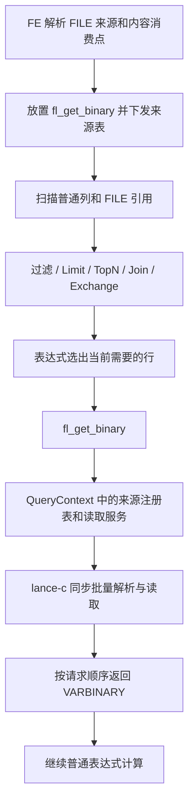

# Doris Lance BLOB 延迟读取设计讨论稿

本文提出以 `fl_get_binary(FILE)` 为内容读取入口的 Lance BLOB 延迟读取方案，供团队讨论和后续实现使用。

当前优先级是 **FE 规划、FILE 读取上下文传递、按需要的行读取 payload**。本阶段采用同步批量读取；异步算子、Pending/waker 和完整表达式恢复机制不作为前置条件。

文档状态：设计讨论稿及本轮重构说明，2026-11-16。源码基准为当前工作区 `a4a24f22f3c9`，包含未提交改动。本文 SQL 未执行；源码路径已调整不代表已经编译或运行验证。

## 0. 本轮范围和实现落点

已确认的 SQL 契约只有两种入口，不再通过 session 决定输出形式：

```sql
SELECT image FROM lance_catalog.db.assets;                 -- descriptor，包括 kind=0
SELECT fl_get_binary(image) FROM lance_catalog.db.assets;  -- 显式读取 payload
```

`lance_blob_as_descriptor` 已从重构源码移除；不保留隐式内联输出兼容模式。当前不设置 Lance payload 专属的单值读取限额。

本轮源码落实引用传递和同步读取，CASE/IF 分支 selector、投影进一步后移及异步执行留到后续阶段。下面涉及这些能力的 SQL 仍是目标案例，不能作为本轮保证。

当前实现选择如下：

- `ColumnFile` 以 binding 字典共享上下文，每行只保存 UInt32 binding ID 和 UInt64 row ID；公开 FILE 仍是六字段。`Field::File` 通过共享不可变 binding 指针保留上下文，不复制 URI 字符串。
- binding 以 `LFB1` 编码保存 query ID、来源 ScanNode ID、dataset URI、固定版本、列名和可选来源 BE；row ID 单独存储，预期长度复用公开 size 字段，不保存 storage options。
- FE 为 Lance scan 参数设置来源 ScanNode ID，沿用 Coordinator 已向参与 BE 下发的完整 `file_scan_params` map 恢复存储配置，没有新增一份重复的凭证表。
- `QueryContext::FileContentReader` 持有独立于 Scanner 的固定版本 dataset 缓存。函数按来源、dataset、版本和列分组，并对同批重复 row ID 去重。
- Block 和内部 PValues 传输统一保存一次 binding 字典及两列紧凑 ID，接收端重建字典，跨列合并时重映射 ID。FILE 统一采用该内部编码，不保留旧编码兼容分支，也不单独提高全局执行版本。独立 arena 行没有字典通道，仍自包含编码，恢复时重新去重；公开 JSON 不导出内部引用。
- 函数处理外层 NULL，inline 值直接返回其内容，Lance descriptor 通过 SDK 读取。未绑定的人工 descriptor 报错；本轮未为 TO_FILE 等其他生产者新增外部读取 provider。
- 扫描直接消费已有 Arrow Blob v2 描述符，构造查询内 `lance-blob://...` 逻辑定位符，不再为输出 FILE 进行逐行 take、HEAD 或完整物理 URI 解析。公开 URI 不包含 dataset URI 中的密码、query 或 fragment；真实 dataset URI 和访问上下文留在内部 binding。FILE.offset 为 NULL。external size=0 保持未知（NULL），managed 的有效空值 size=0 仍保留。消费阶段才按 row ID 解析 SDK handle、校验长度，再逐个 unique handle 同步读取；尚未桥接 Rust 的流式批量 payload API。
- 扫描长度已知时，消费阶段比较 SDK 解析长度与预期长度；未知时直接使用 SDK 实际长度，始终在分配和读取 payload 前校验 VARBINARY 长度表示范围。同长度覆盖仍需要对象版本/条件读取才能检测。
- 本地 dataset、注册本地 base 或绝对本地 external URI 记录来源 BE，并拒绝在其他 BE 上读取。注册 base 通过回移植的上游通用 `lance_dataset_base_paths_json` 元数据接口在每次打开 dataset 时检查；不解析逐值物理位置。含本地 base 的 dataset 保守地将 FILE 绑定到来源 BE。本轮不新增来源 BE 代理回读协议。

这部分是源码现状说明。后续章节保留完整设计和扩展方向；以本节标注界定本轮实际范围。

## 1. 需要解决的问题

Lance BLOB 内容可能远大于普通列。如果在扫描时就将所有 BLOB 读入内存，后续 Filter、LIMIT、TopN、JOIN 或 CASE 丢弃行时，已经付出了无效的网络、内存和复制成本。

仅支持向量查询的两阶段回读不足以覆盖普通查询。我们希望以下查询都能根据内容需求决定读取时机：

```sql
-- 普通列过滤和行数限制之后读取。
SELECT id, fl_get_binary(image)
FROM lance_catalog.db.assets
WHERE category = 'cat'
ORDER BY id
LIMIT 10;

-- 条件分支只读取命中行。
SELECT id,
       CASE WHEN need_image THEN fl_get_binary(image) ELSE NULL END AS content
FROM lance_catalog.db.assets;

-- 同一个 FILE 结果中的不同行可以来自不同来源。
SELECT id, fl_get_binary(image)
FROM (
    SELECT id, image FROM catalog_a.db.assets
    UNION ALL
    SELECT id, image FROM catalog_b.db.assets
) u;
```

目标是减少真正的 payload 读取。描述符读取、manifest 访问、HEAD、索引访问和 payload GET 需要分别讨论；“没有读取 payload”不等于“没有存储 I/O”。

## 2. 当前实现与目标行为

当前精简使用说明见 [lance-blob-v1.md](lance-blob-v1.md)。本表保留重构前行为作对照；本轮源码落点见第 0 节。

| 项目 | 重构前第一版 | 本文目标 |
| --- | --- | --- |
| 类型映射 | 顶层 `lance.blob.v2` 映射为 Doris FILE | 继续沿用 |
| 普通扫描 | 内联模式在 TableReader 构造 Block 时读取 payload | 扫描通常只产生可读取的 FILE 引用 |
| `fl_get_binary()` | 只获取 `FILE.inline`；描述符没有 inline 时返回 NULL | inline 存在时直接返回，否则使用读取引用获取 payload |
| 向量两阶段 | 可按 row ID 回读，回读期间根据模式物化 BLOB | 先取得 FILE 引用；实际内容读取统一由消费点触发 |
| 读取上下文 | 主要由当前 TableReader/dataset 持有 | 查询级来源表 + FILE 逐值读取引用 |
| CASE 按行读取 | 不能保证只执行命中分支的内容读取 | 逐步补齐分支 selector |
| 读取调度 | 同步调用 lance-c | 本阶段仍同步，但按来源和字节预算批量化 |
| 嵌套 BLOB | 当前第一版拒绝 | 引用协议预留叶子级表达能力，实际支持单独分阶段 |

重构前用于设计的关键源码事实（部分已由第 0 节的改动替换）：

- `FunctionFlGetBinary` 当前只访问 inline 子列。
- `ColumnFile` 和 `Field::File` 当前只保存六个公开字段。
- `DataTypeFile` 的 Block 序列化和 `ColumnFile` 的逐值序列化当前没有读取引用。
- `FunctionContext` 可以通过 `RuntimeState` 访问 `QueryContext`。
- 普通标量函数会先计算子表达式，然后同步调用函数实现。
- 当前 CASE 对 ELSE 和部分命中 THEN 的处理尚未实现精确的分支行选择。
- 当前 TopN 延迟物化对透传 slot/alias 有特定规则，不能据此认为任意 `fl_get_binary()` 表达式会自动后移。

源码入口在第 16 节列出。

## 3. 设计原则和本阶段范围

### 3.1 统一内容消费入口

`fl_get_binary(FILE)` 表示显式请求这个 FILE 的完整二进制内容。它是需要远程内容时的统一 SQL 入口；MD5、解码、模型推理等上层函数消费它返回的 VARBINARY，不需要理解 Lance。

读取服务负责存储访问，FE 负责函数位置，表达式负责输入行集合。函数入口统一，不意味着将来源管理、规划和所有存储代码放进一个函数类。

### 3.2 先传引用，按需求读取

Filter、Sort、Limit、Join、Exchange 和 spill 可以传递轻量引用。不能因为某个算子复制、过滤或序列化 FILE，就暗中触发 payload I/O。

### 3.3 读取内容不修改输入 FILE

`fl_get_binary()` 返回独立的 VARBINARY 结果。允许读取服务缓存内容，但不将缓存结果写回原 FILE 的公开 inline 字段。

否则，`element_at(image, 'inline')` 是否为 NULL 可能取决于之前有没有执行过 `fl_get_binary(image)`，导致表达式顺序影响可见值。

### 3.4 来源身份与位置分开

URI、offset、size 描述对象位置，不足以确定使用哪个 endpoint、凭证、base routing 或 dataset snapshot。读取引用需要独立绑定来源。

### 3.5 本阶段必须形成完整路径

本阶段优先实现：

1. 普通查询及向量查询的 FILE 引用产生和传递。
2. 查询级来源配置下发、BE 上的来源注册表和客户端生命周期。
3. 扩展后的 `fl_get_binary()` 和同步批量读取服务。
4. 普通过滤、LIMIT/TopN 后的内容读取放置。
5. 按行 selector 协议，以及逐步完善的 CASE/IF 等表达式。

异步化、自动范围表达式改写、所有嵌套 BLOB 组合和所有函数的分支求值优化可以后续扩展。实现阶段必须明确哪些案例已经覆盖，不能以“统一入口已完成”代替逐场景验证。

## 4. SQL 语义

### 4.1 `fl_get_binary()` 的目标契约

| 输入状态 | 目标结果 | payload I/O |
| --- | --- | --- |
| 外层 SQL NULL FILE | NULL | 无 |
| 非 NULL FILE，inline 非 NULL | 返回 inline，包含零长度二进制 | 无 |
| 非 NULL FILE，inline 为 NULL，有有效读取引用 | 解析并读取完整内容 | 按需 |
| 有效的零长度外部值 | 非 NULL 的零长度 VARBINARY | 不读取 payload 字节；可能需要解析元数据 |
| 外部 FILE 缺少来源绑定 | 明确报错，提示需要绑定来源 | 不猜测凭证 |
| 对象缺失、权限错误、超出大小限制、读取截断 | 查询报错 | 已发生的部分 I/O 按实际记录 |

inline 优先。一个同时带 URI 和 inline 的 FILE，读取内容时使用 inline；完整性规则由 FILE 输入验证负责。

不能用 `inline IS NULL` 判断 FILE 是否为 SQL NULL，也不能用 `size=0` 判断底层描述符是否一定为空值。Lance 的描述符编码可能包含需要解析的长度语义。

### 4.2 直接返回 FILE 与显式读取内容

已确认的接口形式是：

```sql
-- 返回描述符 FILE，不因为返回值而读取 payload。
SELECT id, image FROM lance_catalog.db.assets;

-- 明确请求内容。
SELECT id, fl_get_binary(image) FROM lance_catalog.db.assets;
```

`element_at(image, 'inline')` 仍然只是获取 inline 字段，不自动发起远程读取。它与扩展后的 `fl_get_binary(image)` 不再等价。

公开元数据字段返回描述符实际可提供的信息；未知字段保持 NULL。自动查询真实长度、校验和或 content type 的额外接口不在本节隐式引入。

### 4.3 会话变量：不设置输出模式开关

不提供 `lance_blob_as_descriptor`。Scan 和直接 SELECT 始终输出 descriptor，`fl_get_binary()` 显式读取内容。

当前不设置 Lance payload 专属的单值读取限额。内容读取仍受 VARBINARY 的长度表示范围和查询内存限制约束。

这改变了第一版“descriptor 模式下函数返回 NULL”的行为。调用方不应依赖缺少 inline 来阻止显式内容请求。

### 4.4 错误的可见时机

延迟读取意味着：没有请求内容的行不会因为其 payload 损坏或缺失而报错；真正请求的行读取失败则报错。

CASE 分支跳过的读取应不发生。普通 SQL `AND` 的书写顺序不被定义为远程读取的短路保证；需要由明确的规划规则和表达式执行能力决定哪些普通条件先执行。

## 5. 总体执行模型



内容读取分为三个概念阶段：

```text
RowRef → BlobRef → Payload
```

- RowRef：固定来源、snapshot 下的行与列身份。
- BlobRef：已经取得的 BLOB 描述符及其解析上下文。
- Payload：内容字节。

普通扫描已经返回描述符时保留 BlobRef，避免随后再次按 row ID 查询相同描述符。向量第一阶段只需输出距离和 row ID 时，可以先保留 RowRef，在第二阶段取得 FILE 描述符。

本阶段建议继续使用现有两阶段回读传递 RowRef；进入普通 FILE 表达式的值应已取得合法描述符。不要把只有 row ID、没有合法公开字段的内部占位值直接伪装成现有 FILE。

## 6. FILE 上下文协议

### 6.1 为什么必须逐值绑定

以下结果列的来源可以逐行不同：

```sql
SELECT CASE WHEN use_a THEN a.image ELSE b.image END AS image
FROM catalog_a.db.assets a
JOIN catalog_b.db.assets b ON a.id = b.id;
```

即使 URI 字符串相同，两侧也可能对应不同 endpoint、身份或 snapshot。因此，一个函数、一个 slot 或整个 FILE 列只有一个 context 都不够。

### 6.2 建议的数据结构

以下名称和字段仅表示契约，不是已经定义的 C++/Thrift 类型。实际字段编号需要实现时审计，本文不预分配。

```cpp
struct BlobReadSourceSpec {
    SourceId id;                  // FE 为当前查询分配，跨 fragment 一致
    ProviderKind provider;        // Lance、命名对象存储 resource 等
    DatasetIdentity dataset;      // Lance 场景：有效 URI、固定版本等
    StorageBinding storage;       // 存储配置、授权来源，不进入每行数据
    SourceCapabilities capabilities;
};

struct FileReadRef {
    uint32_t encoding_version;
    SourceId source_id;
    LocatorKind kind;
    OwnedLocator locator;         // 自有数据，不借用 Arrow/Scanner 指针
};

struct FileValue {
    PublicFileFields fields;      // uri, offset, size, content_type, checksum, inline
    optional<FileReadRef> read_ref; // 内部信息，不作为第七个 SQL 字段暴露
};
```

`source_id` 只在当前查询内有效，不使用进程内地址，也不使用 Scanner 临时生成的 BE 本地编号作为全局身份。

Lance source spec 固定 dataset snapshot；locator 固定字段身份、数据文件/fragment 上下文和对应描述符。列名可用于诊断，但不能在后续读取时拿 latest schema 重新解释旧字段。

原始 Lance `kind/position/size/blob_id/blob_uri` 不应由通用表达式解析；其物理含义留在 Lance provider/lance-c 内处理。

### 6.3 内部表示与公开字段

建议让 `ColumnFile` 的每行与其 read ref 不可分离。具体实现可以采用额外的私有列或有类型的辅助存储；常见单一来源可用共享 binding + 行级 locator 压缩。

这种压缩不能改变契约：当 CASE、UNION 或 JOIN 混合来源时，必须能够恢复每行对应的 source ID。

来源信息不只附加在 `ColumnWithTypeAndName` 上。该结构表示整列，不能表达混合来源；很多表达式也会创建新列。

`Field::File` 在六字段 vector 之外保存不可变 binding 的共享指针和 row ID，Column → Field → Column 路径可以保留上下文而不重复分配 URI/列名。

### 6.3.1 本轮的字典压缩实现

```text
ColumnFile:
    public children: uri, offset, size, content_type, checksum, inline
    bindings: [unbound, binding_A, binding_B, ...]
    binding_ids: UInt32[N]
    row_ids: UInt64[N]

Field::File:
    public fields + shared_ptr<const binding> + row_id
```

单一来源列通常只有一个有效 binding；CASE/UNION 等混合来源时，行级 ID 指向各自条目。相同语义的 binding 在目标列中合并，不能原样使用另一个列的局部 ID。

列 clone/filter/permute 共享不可变字典；新增条目时只复制字典索引，不深拷贝已有 binding。批量 insert_range 建立源 ID 到目标 ID 的映射，再拷贝整数列。函数读取请求也共享 binding，不再按行复制 URI。

原始 Block 编码按“字典、binding IDs、row IDs”传输；PValues 使用三个内部组件表示同一信息。接收端先恢复字典再校验 ID 范围，随后按需要重映射到目标列。没有跨 BE 的裸指针或本地注册表编号假设。

以之前 URI=120 字节、列名=20 字节为例，旧逐行引用编码为 216 字节，另有字符串 offsets；现在额外的列式行引用为 12 字节，公共上下文按每个 binding 保存一次。100 万行的额外整数数据约 12 MB（十进制），不包括公开 FILE descriptor、共享对象、容量余量或 transport header。这是结构估算，不是运行期内存/性能测试结果。PValues 的整数 wire 编码大小还取决于 protobuf。

独立 arena 行序列化没有字典侧通道，继续保存完整 binding 和 row ID，以便任意目标列都能恢复；恢复后会重新 intern。它保持正确性，但该路径仍有元数据重复，不能宣称所有 spill/逐行编码都缩减为 12 字节。后续可在具体行容器提供批次字典协议时继续优化。

### 6.4 必须同步覆盖的传递边界

| 边界 | 要求 |
| --- | --- |
| clone、resize、filter、permute | 对应行的引用与公开字段一起变化 |
| insert_from、insert_range_from、selector 拷贝 | 保留来源、顺序和重复行 |
| Column → Field → Column | 不丢失 ref，不将其变成公开字段 |
| CASE/IF/COALESCE 选择 FILE | 返回被选中的值及其 ref |
| UNION ALL | 来源可在同一输出列逐行不同 |
| JOIN 复制行 | 多个输出行可共享同一不可变引用 |
| 外连接产生 NULL | 父级 NULL 生效，不读取占位行的 ref |
| ARRAY/MAP/STRUCT | FILE 叶子引用随叶子复制；父级 NULL 一起生效 |
| Block Exchange | 传输版本化的 ref，接收 BE 可恢复来源 |
| spill/restore、arena 行序列化 | 与列序列化保持同一个内部契约 |
| SQL JSON/文本输出 | 不暴露凭证或内部 query-local token |
| 显式重构 FILE、JSON/字符串 round trip | 不自动继承丢失的读取授权 |

FILE 的 SQL equality、GROUP BY key、DISTINCT 等能力不是本设计自动新增的功能。内部拷贝/序列化能够保留 ref，不代表授予 FILE SQL 比较语义。

### 6.5 版本与缓存边界

公开 FILE schema 保持六字段，不意味着内部 wire format 可以无版本修改。Block 列序列化、逐值序列化和执行版本协商都要能识别新格式。

旧 BE 不能被允许静默丢弃 ref。需要 capability 检查，选择明确拒绝或在受控边界提前物化的兼容策略。

query-local source ID 不可直接保存到跨查询 cache 或持久化结果后再使用。需要重绑定、稳定的来源描述或在该缓存路径禁用此种内部结果复用。公开的描述符 FILE 可以保存其公开字段，但保存公开字段不等于保存读取凭证。

## 7. 查询级来源注册表与生命周期

### 7.1 FE 与 BE 的职责

FE 在有权限的查询上下文中解析来源，为源分配查询内唯一 ID，并固定有效 dataset URI 和版本。引用会流经的 BE 必须收到相应 source spec。

BE 的 QueryContext 保存不可变来源配置，按需初始化客户端或固定版本 dataset。函数通过 `FunctionContext → RuntimeState → QueryContext` 获取服务。

来源表不能只下发到 ScanNode 所在的 BE。执行最终投影的 BE 可能没有扫描过该表。

```text
FE query planning
    → BlobReadSourceSpec 列表
    → 每个需要消费引用的 BE
    → QueryContext.SourceRegistry
    → fl_get_binary 按每行 source_id 解析
```

重复安装相同 source ID 时必须验证描述一致；不同配置不能覆盖为同一个来源。多个 fragment 并发初始化时也要遵守该规则。

### 7.2 来源对象与请求对象分开

| 对象 | 内容 | 生命周期 |
| --- | --- | --- |
| 查询级 source spec | URI、snapshot、存储 binding、能力 | 当前 BE 上的查询 |
| BE SourceContext | 可共享的 SDK/client 对象和不可变配置 | 下游仍可能读取期间 |
| FILE read ref | source ID、版本化 locator | 随 FILE 值传递 |
| 批次读取状态 | 行映射、SDK handle、结果缓冲、去重表 | 本批调用期间 |

Scanner EOF 或关闭不销毁下游仍需使用的来源信息。客户端可以按共享所有权管理，读取请求持有本次需要的 source。

本阶段同步调用的 scratch 不放入所有 FunctionContext clone 共享的可变对象。可以共享来源/客户端，批次行映射和输出列应由当前执行实例持有。

### 7.3 来源恢复伪代码

```cpp
SourceContextPtr SourceRegistry::get_or_open(SourceId id) {
    auto spec = require_registered_spec(id);
    // per-source 初始化，不持有 registry 全局锁执行远程 I/O。
    return clients.get_or_initialize(id, [&] {
        return provider(spec.provider).open_source(
            spec.dataset, spec.storage, query_cancel_context);
    });
}
```

source 初始化可发生元数据 I/O，归入 metadata/profile；它不应在纯 inline 或全 NULL 输入时被无条件触发。

### 7.4 `TO_FILE` 和人工构造的 FILE

为了让一参 `fl_get_binary(FILE)` 在不同 FILE 生产者之间语义一致，`TO_FILE(resource, uri)` 等受控生产者也应将已授权的 resource 绑定到内部 ref。

只有公开 URI、没有读取 binding 的人工构造 FILE，不通过 URI 相似性自动寻找某个 Catalog 的凭证。其 inline 可直接读取；外部内容读取需要明确绑定来源。

只保存公开 FILE JSON 后重新导入的值，同样需要重新绑定。这属于跨查询语义，不能借用旧 query-local source ID。

### 7.5 本地文件与跨 BE

共享对象存储优先由消费 BE 使用 source spec 恢复读取上下文。原扫描 BE 不再是所有 BLOB 读取的必经点。

BE 本地文件不能假定另一个 BE 看到同一路径就有相同内容。该来源必须声明限制，选择保留来源 BE 回读或规划时避免跨越不可恢复边界。未实现相应路由前应明确拒绝该场景，不能错误地按接收 BE 的本地路径读取。

## 8. FE 规划规则

### 8.1 为函数建立明确的属性

`fl_get_binary()` 需要表达以下属性：

- 请求 FILE 内容，可能访问外部存储。
- 需要运行期来源上下文。
- 读取可能失败，需要保留条件依赖。
- 只消费当前传入的行，不隐式读取原 Block 的其他行。
- 内容读取成本可能很高，允许在满足语义的前提下后移。

这些属性不简单等同于一个 `nondeterministic` 标记。固定 snapshot 的不可变对象和可覆盖的 external 对象，其缓存/复用保证不同。

### 8.2 安全的后移条件

只有当表达式结果不参与经过的过滤、排序、JOIN key 或其他操作所需计算，输入引用仍然可用，且不改变相关表达式语义时，才后移读取。

| 经过的节点 | 适合后移的情况 | 必须提前读取的情况 |
| --- | --- | --- |
| Filter | payload 仅用于输出，Filter 不依赖它 | Filter 使用内容 |
| Limit/TopN | 排序键和行选择不依赖内容 | 排序键使用内容 |
| Join | FILE 仅为输出，行身份/值可正确传递 | Join 条件使用内容 |
| Aggregate | 仅有可合法保留的值/引用路径时逐案处理 | 聚合参数使用内容；不能绕过聚合输入需求 |
| Window | 输出内容与窗口求值独立且引用保留 | 窗口参数/分区/排序依赖内容 |
| Exchange | 接收 BE 有来源配置且 wire format 支持 | 来源无法在接收端恢复 |

这不是允许将任何函数跨任意节点移动。复杂表达式、非确定函数、外连接和聚合的合法性需要按现有优化器规则判断。

### 8.3 投影后移伪代码

```text
for each content-read expression E = fl_get_binary(file_expr):
    identify E's argument lineage and all uses of E's result
    retain FILE values/read refs needed by E
    choose the latest legal evaluation boundary

    when crossing a node N:
        if N needs E's result:
            stop before N
        if input value/ref cannot be preserved across N:
            stop or choose an explicitly supported fetch path
        if expression movement changes required semantics:
            stop

    place E at the selected boundary
    retain branch guards and runtime source bindings
```

例如普通 SQL 的目标计划：

```text
Project[id, fl_get_binary(image)]
  TopN[order by id, limit 10]
    Filter[category = 'cat']
      LanceScan[id, category, image_ref]
```

Scan 输出的 `image_ref` 是带来源的轻量 FILE，不是 payload。

### 8.4 避免绕过函数入口的提前读取

仅移动 SELECT 中的函数不够。还要检查 Scanner 的投影执行、公共子表达式投影和两阶段回读，确保内容请求没有被提前计算。直接输出完整 FILE 不再隐式读取 payload。

向量第二阶段的 `take_rows` 取得描述符后，如果立即按旧内联模式读取内容，仍然无法支持后续 CASE 再筛选。目标是回读和内容消费解耦。

### 8.5 常量、公共子表达式与条件依赖

- 非 NULL inline 常量可有纯计算 fast path；引用外部来源的表达式不得在 FE 常量折叠时读取内容。
- 保守实现可以先关闭该函数的默认常量执行路径，再单独恢复安全的 inline 优化。
- 公共子表达式提取不能将分支内读取无条件提升到 CASE 之外。
- 重复读取可以在同一输入批次内按来源和 locator 合并；不要为了去重而提前请求本来不会求值的行。
- `length(fl_get_binary(image))` 不能自动改为元数据 size 后就跳过原有错误/大小限制语义。需要独立定义合法规则。

## 9. 按行读取与函数执行

### 9.1 selector 的单一解释

当前表达式框架可以使用 selector 将原 Block 的指定行压缩成函数参数列。函数可以直接处理压缩后的 `input_rows_count` 行。

```text
原 Block 行：0 1 2 3 4 5
selector：  1 4 5
函数输入：  原行 1、4、5 对应的 FILE
函数输出：  3 行 VARBINARY
```

如果子表达式已经按 selector 生成压缩列，函数不能再次将原 selector 应用到该压缩列。接口必须明确行编号属于原 Block 还是当前函数输入。

外层条件表达式负责将分支结果放回对应输出位置。

### 9.2 `fl_get_binary()` 批次伪代码

以下伪代码省略真实 IColumn API。默认 NULL 包装和函数内部显式处理可以二选一，但最终契约必须等价。

```cpp
BinaryColumn fl_get_binary(FileColumn files, RuntimeContext runtime) {
    BinaryColumn output(files.size());
    RequestGroups groups;

    for (InputRow row : files.rows()) {
        runtime.check_cancelled();

        if (files.is_sql_null(row)) {
            output.set_null(row);
        } else if (files.inline_is_present(row)) {
            output.set_inline_value(row, files.inline_value(row));
        } else {
            auto ref = files.require_read_ref(row);
            groups.add(ref.source_id, ref, /*output_position=*/row);
        }
    }

    // 全 NULL/inline 批次不要求存在外部来源，也不初始化远程客户端。
    if (groups.empty()) {
        return output;
    }

    auto& service = runtime.query_context().blob_read_service();
    for (auto& group : groups) {
        auto source = service.sources().get_or_open(group.source_id);
        auto unique = deduplicate_within_batch(group.requests);

        // known-size 可提前拒绝；未知长度需要先解析，随后在分配/GET 前检查。
        auto resolved = source.resolve(unique.refs);
        validate_sizes_and_reserve_memory(resolved, runtime);

        for (auto batch : split_by_byte_budget(resolved)) {
            runtime.check_cancelled();
            auto data = source.read_full_batch_sync(batch);
            validate_result_count_and_lengths(batch, data);
            scatter_to_output(data, unique.output_positions, output);
        }
    }
    return output;
}
```

此处去重 key 至少包含来源、locator 和相应不可变身份信息。不能只用 URI 或 row ID；不同 snapshot、不同列或不同来源的值不能混淆。

结果保留请求顺序和重复行。去重只减少读取，不删除输出行。已选择的非 NULL 引用如果不存在，应作为错误，而不是将其误判为 NULL 或少返回一行。

当前不设置 Lance 专属的单值读取限额，已有 inline 值保留访问语义。是否另设通用 FILE 内容限额可后续讨论。

### 9.3 CASE 的目标伪代码

```text
remaining = input_selector
result = empty_result_for_input_rows

for each WHEN condition, THEN value:
    condition_values = evaluate(condition, rows=remaining)
    selected = remaining rows whose condition is SQL TRUE

    if selected is not empty:
        branch_values = evaluate(value, rows=selected)
        scatter(branch_values, selected, result)

    remaining = remaining minus selected
    if remaining is empty:
        break

if remaining is not empty:
    if ELSE exists:
        scatter(evaluate(ELSE, rows=remaining), remaining, result)
    else:
        fill_SQL_NULL(remaining, result)
```

组合已有父 selector 时，必须正确维护原 Block 行位置和压缩结果位置的映射。WHEN 为 NULL 按 SQL 规则不命中。

若 WHEN 本身消费 BLOB，则只对当前 remaining 求值。ELSE 不提前执行。未命中 THEN 不执行读取。

### 9.4 表达式支持可以逐步完善

| 表达式形态 | 读取行集合 | 计划 |
| --- | --- | --- |
| `fl_get_binary(image)` | 当前输入行 | 基础能力 |
| `md5(fl_get_binary(image))` | 当前输入行 | 基础能力 |
| `fl_get_binary(CASE ... THEN image_a ELSE image_b END)` | CASE 选出的 FILE 值 | 来源传递的重要基础案例；候选引用求值不等于 payload 读取 |
| `CASE ... THEN fl_get_binary(image) ELSE NULL END` | 命中 THEN 的行 | 补齐 CASE selector |
| `IF(cond, fl_get_binary(a), fl_get_binary(b))` | 各自命中行 | 检查并改造条件执行路径 |
| COALESCE 中的内容读取 | 尚未取得非 NULL 结果的行 | 单独实现和验证 |
| 普通 AND/OR 条件 | 由已实现的求值协议决定 | 不承诺书写顺序天然短路 |

通用函数调用当前先计算所有参数。不能仅因为函数名叫 IF/COALESCE，就认为给它传入的 BLOB 参数会自动按分支延迟执行。

## 10. lance-c 与同步批量读取服务

### 10.1 职责边界

| 层 | 职责 |
| --- | --- |
| FE | 来源绑定、固定 snapshot、函数放置和依赖 |
| FILE/表达式 | 传递逐值 ref、选择输入行 |
| `fl_get_binary()` | NULL/inline fast path、提交内容请求、构造 VARBINARY |
| 查询级读取服务 | 来源解析、批次预算、去重、取消、统计 |
| Lance provider/lance-c | 解释 BLOB 描述符、base routing、存储访问、批量调度 |

通用函数不拼接 `.blob` 文件名、不解释 Lance kind、不套用其他表格式的偏移规则。

### 10.2 必要的 provider 能力

```cpp
interface BlobProvider {
    SourceContext open_source(SourceSpec spec);
    ResolvedRefs resolve_refs(SourceContext source, FileReadRefs refs);
    ReadResults read_full_batch_sync(ResolvedRefs refs, ReadBudget budget);
    PublicDescriptors export_descriptors(ResolvedRefs refs);
}
```

`resolve_refs()` 可以访问元数据，但不主动物化 payload。普通扫描已经取得描述符时，应支持直接消费其信息，不重复按 row ID 读取描述符。

已有 Rust SDK 具备批量完整内容读取、范围读取和流式结果能力。lance-c 应优先桥接这些能力。直接消费扫描描述符所需的 helper 尚未全部公开；应明确桥接或补充窄接口，不能仅包装 `take_blobs()` 就认为消除了重复读取。

### 10.3 本阶段同步调度

`fl_get_binary()` 标记为可能阻塞。现有表达式递归传播该属性，并由 hybrid scheduler 使用 blocking scheduler。

读取批次内部可以并发进行存储 I/O，但 Doris 函数调用同步等待完成。线程在等待期间仍被占用；本文不将它称为真正的非阻塞执行。

不改造 VExpr Pending 返回值，不引入新的异步读取算子。未来异步实现可以复用 source/ref 协议和读取服务，不需要为本阶段提前引入回调生命周期。

### 10.4 内存与取消

至少分别控制：

- 单个完整内容的最大字节数。
- 当前结果列及复制产生的内存。
- 读取批次的预期和实际字节数。
- SDK 在途缓冲和并发读取的字节数。
- 查询内去重/cache 的内存上限。

不能只按 `batch_size` 限制行数，也不能只给最终 Doris 列记账而漏掉 Rust 缓冲。查询内存不足或取消时应停止后续批次，释放临时 handle 和缓冲；不要把业务读取错误替换成 NULL。

## 11. SQL 案例与预期执行行为

### 11.1 示例约定

假设存在 Lance 表 `lance_catalog.db.assets`，包含：

```text
id          BIGINT，示例中可唯一标识一行
category    STRING
need_image  BOOLEAN
image       FILE，对应顶层 scalar lance.blob.v2
thumbnail   FILE，对应另一列 BLOB
embedding   向量列，具体类型由测试数据决定
```

其他 Catalog 的示例表具有兼容 schema。示例不包含建表、Catalog 凭证和数据准备步骤。

当前 reader 前提仍为：

```sql
SET enable_file_scanner_v2 = true;
```

上述变量已存在，函数读取已接入重构源码；下述进一步规划/selector 行为尚未实现，全部案例均未运行。`enable_lance_lazy_materialization` 仅对应现有 Lance 搜索两阶段能力，不是普通查询完整延迟读取功能的现成开关。

### 11.2 仅获取描述符或 NULL 状态

```sql
SELECT id,
       image IS NULL AS image_is_null,
       element_at(image, 'uri') AS uri,
       element_at(image, 'offset') AS byte_offset,
       element_at(image, 'size') AS byte_size
FROM lance_catalog.db.assets
WHERE category = 'cat';
```

预期不读取 payload。当前扫描输出逻辑定位符，直接复用已有描述符，不额外解析逐值物理范围或真实对象长度。

### 11.3 普通过滤后读取

```sql
SELECT id, fl_get_binary(image) AS content
FROM lance_catalog.db.assets
WHERE category = 'cat';
```

目标是先执行普通列过滤，再按批读取剩余行的 image。过滤可由 Lance 下推执行，也可由 Doris 执行；后者同样不能因为未下推就提前读取所有 payload。

### 11.4 TopN 后读取

```sql
SELECT id, fl_get_binary(image) AS content
FROM lance_catalog.db.assets
WHERE category = 'cat'
ORDER BY id
LIMIT 10;
```

目标是全局 TopN 完成后读取最多 10 个输出行对应的 BLOB。若多个输出行引用同一值，读取去重可进一步减少请求数。

不能在各个 split 的局部 TopN 之后就宣称“只读最终 10 行”；读取位置必须位于真正收敛行数的计划节点之后。没有 ORDER BY 的 LIMIT 也可减少读取，但不承诺选中哪 10 行。

### 11.5 payload 参与过滤

```sql
SELECT id
FROM lance_catalog.db.assets
WHERE category = 'cat'
  AND md5(cast(fl_get_binary(image) AS STRING)) = '0123456789abcdef0123456789abcdef'
LIMIT 10;
```

`category` 可以先筛掉一部分行；剩余候选行需要读取 image 才能判断 MD5 条件。不能保证只读取最终 10 行，也不能仅凭 AND 的书写顺序宣称已经短路。

对应规划应明确区分普通过滤和内容过滤。具体是否后移/重排还要满足表达式与错误语义。

### 11.6 payload 参与排序

```sql
SELECT id
FROM lance_catalog.db.assets
WHERE category = 'cat'
ORDER BY md5(cast(fl_get_binary(image) AS STRING)), id
LIMIT 10;
```

排序键需要内容，因此读取发生在排序之前。延迟读取可利用 category 过滤，但不能跨过该排序。

### 11.7 CASE 中只读取命中行

```sql
SELECT id,
       CASE WHEN need_image
            THEN fl_get_binary(image)
            ELSE NULL
       END AS content
FROM lance_catalog.db.assets;
```

CASE selector 完成后的目标：need_image 为 TRUE 的行读取 image；FALSE/NULL 行不读取该分支内容。当前源码尚不提供该保证。

下面的表达式还要求 ELSE 只处理未命中行：

```sql
SELECT id,
       CASE WHEN need_image
            THEN fl_get_binary(image)
            ELSE fl_get_binary(thumbnail)
       END AS content
FROM lance_catalog.db.assets;
```

### 11.8 先选择 FILE，再读取一次

```sql
SELECT id,
       fl_get_binary(
           CASE WHEN need_image THEN image ELSE thumbnail END
       ) AS content
FROM lance_catalog.db.assets;
```

CASE 的值选择只传递 FILE 和 ref；函数最终只读取选中的 FILE 内容。即使两个候选引用都已经取得描述符，也不需要两个 payload。

这是一条独立的重要路径：必须验证 CASE 构造结果列时没有丢失 ref，不能只验证原始 slot 直接调用函数。

### 11.9 JOIN 之后读取及重复引用

```sql
SELECT a.id, fl_get_binary(a.image) AS content
FROM lance_catalog.db.assets a
JOIN internal_db.allowed_ids b ON a.id = b.id
WHERE b.enabled = true
ORDER BY a.id
LIMIT 10;
```

image 不参与 JOIN key 和普通条件，可在 JOIN 和 TopN 后读取。若 JOIN 复制一行，对应 FILE ref 也被复制；批次内可按相同引用去重，再将字节散布回多个结果行。

LEFT JOIN 的右侧 FILE 为空时，外层 SQL NULL 必须阻止对占位行发起读取。

### 11.10 混合来源与 Exchange

```sql
SELECT id, fl_get_binary(image) AS content
FROM (
    SELECT id, image FROM catalog_a.db.assets
    UNION ALL
    SELECT id, image FROM catalog_b.db.assets
) u
ORDER BY id
LIMIT 20;
```

接收 BE 按每行 source ID 找到对应的来源配置，不能用函数实例固定的一个 dataset 读取整列。

即使两边 URI 文本相同，也不能直接合并为一个去重 key。source ID/授权上下文不同，可能指向不同对象或访问身份。

### 11.11 向量查询

```sql
SET enable_lance_lazy_materialization = true;

SELECT id, fl_get_binary(image) AS content, _distance
FROM vector_search(
    "table" = "lance_catalog.db.assets",
    "column" = "embedding",
    "query_vector" = "[0.1,0.2,0.3,0.4]",
    "top_k" = "10",
    "metric" = "l2"
)
ORDER BY _distance;
```

向量维度和参数必须与实际数据一致。目标路径：向量检索产生距离和行身份 → 全局 TopN → 按固定 snapshot 回读 id 和 image 描述符 → `fl_get_binary()` 读取输出行内容。

第二阶段不因旧的内联模式自动提前读取所有回读 BLOB。若上层还有 CASE，可继续只读取选中行。

### 11.12 聚合与嵌套值边界

```sql
-- 只需要有效性，不需要内容。
SELECT count(image) FROM lance_catalog.db.assets;

-- 聚合参数确实需要每个输入值的内容。
SELECT sum(length(fl_get_binary(image)))
FROM lance_catalog.db.assets
WHERE category = 'cat';
```

第二条不能因为最终只输出一行而将读取推迟到聚合后。也不能未经语义论证就用描述符 size 替代 `length(fl_get_binary())`。

未来 `ARRAY<FILE>`/`MAP<STRING,FILE>` 支持后，以下形态应只读取所选叶子，保留父级和叶子 NULL：

```sql
-- 未来能力示意，当前第一版不支持该嵌套 Lance BLOB 映射。
SELECT fl_get_binary(images[1]), fl_get_binary(assets['preview'])
FROM lance_catalog.db.nested_assets;
```

## 12. 一致性、失效和错误处理

### 12.1 固定 snapshot

普通扫描、两阶段回读和内容解析使用同一个已解析的 dataset 版本。source spec 不保存未解析的 latest 语义用于后续重新打开。

读取过程中 catalog 配置变化、表新增 snapshot 或列重命名，不应将旧 ref 解释成新来源或新字段。

### 12.2 External BLOB 的内容一致性

固定 dataset snapshot 只固定引用，不保证外部对象没有被覆盖。若来源有对象 version ID、ETag 或其他可用于条件读取的身份，应纳入解析/读取契约。

没有这些能力时，需要明确 external 内容采用读取时的对象状态，不承诺与 managed immutable 文件相同的一致性。已知长度和实际读取长度不符应报错，不能默默截断。

### 12.3 vacuum 与缺失对象

查询仍在使用的 managed 文件若被清理，读取应返回明确错误。SDK handle 或 manifest 对象在内存中存活，并不等于底层文件被自动保护。

与外部系统的保留策略/活跃查询保护需要单独约定。禁止在固定 snapshot 读取失败后回退 latest。

### 12.4 日志和授权边界

来源配置只在受控查询参数中下发，不放进 FILE 的公开字段、每行序列化的凭证或 Profile 文本。URI 本身可能带 query 参数，日志和 EXPLAIN 应按现有规则脱敏。

未知 source ID、来源冲突、缺少 binding、locator 版本不支持等应报错；不能猜测一个“看起来能访问”的 resource。

## 13. 可观察性与验收设计

本节是后续验证计划，不表示已创建或运行测试。

建议为函数/读取服务提供以下信息，具体名称可实现时统一：

| 指标 | 用途 |
| --- | --- |
| 输入 FILE 行数、外层 NULL 行数、inline 命中行数 | 判断是否无效访问读取服务 |
| 请求 ref 数、去重后 ref 数 | 判断重复表达式/JOIN 的读取放大 |
| 描述符解析行数、元数据请求数、HEAD 次数 | 区分引用解析与 payload |
| 请求 payload 字节数、实际存储读取字节数 | 区分逻辑需求、缓存与读取放大 |
| payload 请求数、批次数、同步等待时间 | 评估批量读取效率 |
| SDK 缓冲和 Doris 输出的峰值内存 | 约束物化内存 |
| 来源打开次数、来源缓存命中 | 检查是否反复重新打开 dataset |

EXPLAIN 应能看出内容读取表达式的位置、来源标识和 FILE ref 投影。不能只看到 `enable_lance_lazy_materialization=true` 就判定已延迟读取。

建议验收矩阵：

| 维度 | 必须验证的情况 |
| --- | --- |
| 值语义 | SQL NULL、空 inline、空外部值、二进制零字节、超限、缺失对象 |
| FE | 普通过滤、全局 Limit/TopN、内容过滤、内容排序、JOIN 后投影 |
| 表达式 | 原始 slot、alias、CASE 返回 FILE、CASE/IF 返回内容、重复函数 |
| 上下文 | 多 Catalog、不同 snapshot、同 URI 不同来源、TO_FILE 生产者 |
| 数据传递 | 单 BE、多 BE Exchange、UNION ALL、JOIN 复制、外连接 NULL |
| 内部编码 | Column/Field round trip、列序列化、arena 行序列化、spill/restore |
| Lance 布局 | Inline/Packed/Dedicated/External、base routing、已读取描述符复用 |
| 生命周期 | Scanner 已关闭、查询取消、超时、来源初始化失败、旧协议 BE |
| 后续嵌套 | ARRAY/MAP/STRUCT 叶子引用与父级 NULL，未实现前明确拒绝 |

验证应同时检查值正确性和读取行为。例如 CASE 返回正确值但读取了两个分支，仍不满足该场景的延迟读取目标。没有 payload I/O 的场景也允许存在必要的描述符/元数据访问。

## 14. 实施拆分和依赖

### 阶段 A：确定语义和内部协议

确定 `fl_get_binary()` 的新语义、逐值 ref 编码、查询级来源表和未知 binding 错误规则。整 FILE 输出始终为 descriptor，不设置切换模式。

此阶段的产物是可审阅的接口与 wire format 方案，不需要先完成异步化。

### 阶段 B：来源传递和读取服务

扩展 FILE 的内部 ref 表示和各类拷贝/序列化路径；完成 FE source spec 下发、BE registry、固定 snapshot 和同步批量 provider。

这一阶段重点证明引用经过混合来源、Field 转换和 Exchange 后仍可正确读取。

### 阶段 C：统一函数入口和普通查询规划

扩展 `fl_get_binary()`；扫描改为引用输出；普通投影在合法范围后移至过滤和行数收敛之后；向量两阶段改为回读 FILE 引用。

同一接口可以先覆盖同步调用，不引入 Pending 状态。

### 阶段 D：逐步完善按行表达式

优先 CASE，再检查 IF/COALESCE 等。每个表达式明确 selector 契约和未命中分支行为，补齐前不宣称具有精确按分支读取能力。

嵌套 BLOB 可基于同一叶子 ref 协议独立扩展，不能让当前拒绝的类型静默走未实现路径。

### 后续阶段

根据性能证据决定异步物化、范围读取函数和合法的范围表达式改写。异步化复用现有来源/ref/预算协议，不重新定义 SQL 内容读取入口。

编译和测试按用户后续安排执行。本设计文档不授权或记录任何已经完成的编译/运行结果。

## 15. 待团队确认的决策

核心方向已经收敛：扩展 `fl_get_binary()`，FE 放置消费点，FILE 逐值保存来源引用，同步批量读取，expr 行选择逐步完善。

以下细节建议在实现前明确：

1. 已决定：直接 SELECT 始终输出 descriptor，FL_GET_BINARY 读取 payload，不保留 session 输出切换；需要确认对其他 FILE 生产者的扩展顺序。
2. 本轮已将 URI/列名等公共身份信息提取为 binding 字典，并统一使用包含读取上下文的内部编码；后续是否为独立 arena 行容器增加批次字典协议。
3. 当前不设置 Lance payload 专属限额；后续是否引入通用 FILE 内容限额。
4. 缺少来源的人工 FILE 如何显式绑定；跨查询持久化结果是否只保存公开描述符。
5. 本阶段支持哪些非共享本地存储场景，未支持场景采用何种明确的规划限制。
6. External BLOB 没有对象版本信息时的内容一致性和缓存策略。
7. 最早交付批次对 CASE、IF、嵌套 FILE 的覆盖范围，避免将接口预留误认为实现完成。

## 16. 源码与修改边界索引

### 16.1 Doris 当前入口

| 文件 | 当前职责 / 计划关注点 |
| --- | --- |
| [FE FlGetBinary](../fe/fe-core/src/main/java/org/apache/doris/nereids/trees/expressions/functions/scalar/FlGetBinary.java) | 函数签名、语义属性 |
| [LanceTypeConverter](../fe/fe-core/src/main/java/org/apache/doris/datasource/lance/metadata/LanceTypeConverter.java) | BLOB → FILE 类型映射 |
| [LanceScanNode](../fe/fe-core/src/main/java/org/apache/doris/datasource/lance/source/LanceScanNode.java) | 扫描、搜索参数、snapshot 和来源下发 |
| [LazyMaterializeTopN](../fe/fe-core/src/main/java/org/apache/doris/nereids/processor/post/materialize/LazyMaterializeTopN.java) | 现有 TopN 延迟物化 |
| [MaterializeProbeVisitor](../fe/fe-core/src/main/java/org/apache/doris/nereids/processor/post/materialize/MaterializeProbeVisitor.java) | 现有来源识别和 slot/alias 规则 |
| [Coordinator](../fe/fe-core/src/main/java/org/apache/doris/qe/Coordinator.java) | fragment 查询资源下发 |
| [PlanNodes.thrift](../gensrc/thrift/PlanNodes.thrift) / [PaloInternalService.thrift](../gensrc/thrift/PaloInternalService.thrift) | scan 参数、查询来源协议；新字段需独立审计 |
| [BE fl_get_binary](../be/src/exprs/function/function_fl_get_binary.cpp) | 当前 inline 访问；目标内容消费入口 |
| [VectorizedFnCall](../be/src/exprs/vectorized_fn_call.cpp) | 参数求值、selector、同步函数调用 |
| [VCaseExpr](../be/src/exprs/vcase_expr.cpp) | 分支求值和 selector 改造 |
| [FunctionContext](../be/src/exprs/function_context.h) | 访问 RuntimeState、共享/局部状态 |
| [TO_FILE](../be/src/exprs/function/function_to_file.cpp) | 命名 resource 获取与 FILE 生产者 binding |
| [QueryContext](../be/src/runtime/query_context.h) / [fragment_mgr](../be/src/runtime/fragment_mgr.cpp) | BE 查询级资源安装与生命周期 |
| [ColumnFile](../be/src/core/column/column_file.cpp) / [Field](../be/src/core/field.h) | 逐值 ref 拷贝、Column/Field 互转 |
| [DataTypeFile](../be/src/core/data_type/data_type_file.cpp) | Block 编解码和执行版本 |
| [FILE SerDe](../be/src/core/data_type_serde/data_type_file_serde.cpp) | 对外六字段格式，不输出内部凭证 |
| [LanceTableReader](../be/src/format_v2/table/lance_reader.cpp) | 当前批次物化和 row ID 回读，目标引用产生 |
| [Lance BLOB reader](../be/src/format_v2/lance/lance_blob_column_reader.cpp) | 当前同步内容/描述符读取，provider 重构参考 |
| [LanceSessionManager](../be/src/format_v2/lance/lance_session_manager.h) | 进程级 SDK session；不等同于查询级来源注册表 |
| [HybridTaskScheduler](../be/src/exec/pipeline/task_scheduler.cpp) | 本阶段 blocking scheduler 路由 |

### 16.2 固定版本 Lance 源码

当前 [thirdparty/vars.sh](../thirdparty/vars.sh) 固定 lance-c 为 `4fafcd64525b274b113208390bbcca86bbbc093b`，其 Cargo 依赖固定 Lance 为 `68c12dfd7efe02f90ad2d7f3a239a7eb64884e57`。

- [lance-c blob.rs](https://github.com/lance-format/lance-c/blob/4fafcd64525b274b113208390bbcca86bbbc093b/src/blob.rs)：当前同步 BLOB handle 接口。
- [lance-c runtime.rs](https://github.com/lance-format/lance-c/blob/4fafcd64525b274b113208390bbcca86bbbc093b/src/runtime.rs)：全局 Tokio runtime 与同步 block_on。
- [固定 Lance dataset/blob.rs](https://github.com/lance-format/lance/blob/68c12dfd7efe02f90ad2d7f3a239a7eb64884e57/rust/lance/src/dataset/blob.rs)：BLOB 解析、批量/范围读取 builder 与调度。
- [本地 lance-c base-path patch](../thirdparty/patches/lance-c-base-paths.patch)：仅回移植上游通用 base-path 元数据查询，支持本地存储放置检查；不再提供 FILE 专用物理描述符解析接口。

上述结论基于本地固定版本源码阅读，不以其他工作区的 master snapshot 代替当前依赖版本。本文未进行网络版本刷新或运行验证。
